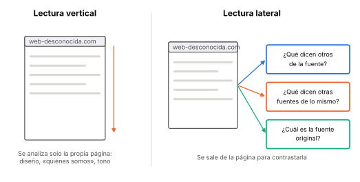
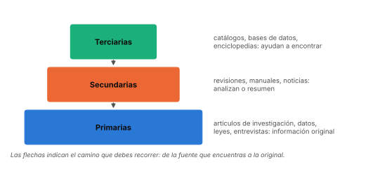
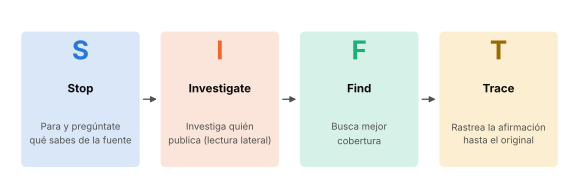

# Unidad 1. Introducción. Fuentes de información {#sec-u1}

::: {.callout-note appearance="default"}
## Objetivos
- Reconocer la sobrecarga informativa y los distintos tipos de desinformación.
- Usar la información digital de forma crítica, reflexiva y proactiva.
- Identificar, seleccionar y evaluar fuentes de información, incluidas las redes sociales como fuente científica.
:::

::: {.callout-note appearance="simple" icon="false"}
## Glosario de la unidad
[Sobrecarga informativa](92-glosario.qmd#gl-sobrecarga) · [Desinformación](92-glosario.qmd#gl-desinformacion) · [Información errónea](92-glosario.qmd#gl-erronea) · [Credibilidad](92-glosario.qmd#gl-credibilidad) · [Lectura lateral](92-glosario.qmd#gl-lateral) · [Método SIFT](92-glosario.qmd#gl-sift) · [Fuente primaria](92-glosario.qmd#gl-primaria) · [Revisión por pares](92-glosario.qmd#gl-pares) · [Altmetría](92-glosario.qmd#gl-altmetria)
:::

::: {.callout-tip appearance="simple" icon="false"}
## Descargas
[Plantilla de entrega del reto (.qmd)](plantillas/entrega_reto.qmd){.btn .btn-outline-primary .btn-sm download="entrega_reto.qmd"}
[Tema de estilo (.scss)](plantillas/informe.scss){.btn .btn-outline-primary .btn-sm download="informe.scss"}

La plantilla `.qmd` y su tema `.scss` sirven para redactar la entrega de los retos: guárdalos en la misma carpeta.
:::

## Lectura obligatoria

::: {.lectura}
Metzger, M. J.; Flanagin, A. J. (2013). [Credibility and trust of information in online environments: The use of cognitive heuristics](https://doi.org/10.1016/j.pragma.2013.07.012). *Journal of Pragmatics*, 59, 210-220.
:::

### Lecturas complementarias {.unnumbered}

- @bawden2009 — La sobrecarga informativa y sus efectos.
- @pennycook2021 — Por qué creemos y compartimos noticias falsas.
- @sugimoto2017

## 1. Información, sobrecarga y desinformación

Nunca ha sido tan fácil acceder a información, y nunca ha sido tan difícil saber cuál es fiable. @bawden2009 describen el «lado oscuro» de la información: la **sobrecarga informativa** (más información de la que se puede procesar), la ansiedad que provoca y otros efectos paradójicos, como sentirse peor informado cuanta más información se recibe.

En el terreno de la información falsa conviene distinguir:

| Tipo | Qué es | Ejemplo |
|---|---|---|
| **Información errónea** (*misinformation*) | Falsa, pero se comparte sin intención de engañar | Reenviar un remedio casero ineficaz creyendo que funciona |
| **Desinformación** (*disinformation*) | Falsa y creada o difundida para engañar | Una campaña con datos inventados para influir en unas elecciones |
| **Información maliciosa** (*malinformation*) | Verdadera, pero usada para causar daño | Difundir datos personales reales de alguien |

@pennycook2021 muestran que mucha gente comparte información falsa no tanto por sesgo ideológico como por **falta de atención**: no se para a pensar si es verdad antes de compartirla. Una pausa breve mejora el juicio.

## 2. Uso crítico, reflexivo y proactivo

@metzger2013 explican que, en línea, las personas no evalúan la credibilidad de forma sistemática, sino con **atajos mentales** (heurísticos): la **reputación** (una marca conocida parece fiable), el **respaldo** de otros (muchas reseñas o «me gusta»), la **coherencia** (lo que se repite en varios sitios), la **violación de expectativas** (un diseño descuidado o errores hacen desconfiar) y la **intención persuasiva** (si parece que quieren vender algo, desconfiamos). Esos atajos son útiles, pero se pueden explotar: una web falsa puede imitar una marca conocida y las reseñas se pueden comprar.

Un uso crítico de la información consiste en sustituir, cuando importa, el atajo por la comprobación. Para eso funciona mejor la **lectura lateral** que la lectura vertical: en lugar de analizar a fondo la página (que puede estar diseñada para parecer fiable), se abren otras pestañas para averiguar qué dicen **otros** sobre esa fuente y esa afirmación. Es lo que hacen los verificadores profesionales.

El método **SIFT**, propuesto por Mike Caulfield, resume la lectura lateral en cuatro pasos:

1. **Para** (*Stop*): antes de leer o compartir, pregúntate si conoces la fuente.
2. **Investiga la fuente** (*Investigate the source*): quién está detrás y qué intereses tiene.
3. **Busca mejor cobertura** (*Find better coverage*): qué dicen otras fuentes fiables sobre lo mismo.
4. **Rastrea hasta el original** (*Trace claims*): busca la fuente primaria de la afirmación, la cita o la imagen.

{#fig-lateral fig-alt="A la izquierda, una sola página web con una flecha que baja por ella: lectura vertical. A la derecha, la misma página con flechas que salen hacia tres pestañas: qué dicen otros de la fuente, qué dicen otras fuentes sobre lo mismo y la fuente original de la afirmación."}

## 3. Identificar, seleccionar y evaluar fuentes

Las fuentes se suelen clasificar en **primarias** (información original: un artículo de investigación, unos datos, una ley, una entrevista), **secundarias** (analizan o resumen las primarias: una revisión, un libro de texto, una noticia sobre un estudio) y **terciarias** (ayudan a encontrar las anteriores: catálogos, bases de datos, enciclopedias).

Para seleccionarlas, la pregunta clave es **qué necesito**: una definición, datos actualizados, la evidencia científica sobre un tema, la normativa vigente. Para evaluarlas, una lista útil es:

| Criterio | Preguntas |
|---|---|
| **Autoría** | ¿Quién lo firma? ¿Tiene conocimiento del tema? ¿Hay una organización responsable? |
| **Propósito** | ¿Informa, opina, vende, persuade? |
| **Actualidad** | ¿Cuándo se publicó o se actualizó? ¿Importa la fecha para tu tema? |
| **Exactitud** | ¿Cita sus fuentes? ¿Se puede comprobar? ¿Coincide con otras fuentes fiables? |
| **Revisión** | ¿Ha pasado una revisión por pares, una edición profesional o ningún control? |

{#fig-fuentes fig-alt="Tres niveles apilados: arriba, fuentes terciarias (catálogos, bases de datos, enciclopedias, que ayudan a encontrar); en medio, secundarias (revisiones, manuales, noticias, que analizan o resumen); abajo, primarias (artículos de investigación, datos, leyes, entrevistas: información original). Flechas descienden de las terciarias a las primarias."}

## 4. Las redes sociales como fuente de información científica

Las redes sociales se usan cada vez más para difundir y comentar la ciencia. @sugimoto2017 revisan cómo las usan los investigadores y cómo se miden esas menciones (**altmetría**). Para una estudiante, las redes pueden servir para **descubrir** investigaciones y debates recientes, pero no son la fuente: hay que llegar al artículo original. Conviene recordar que:

- Una publicación viral sobre un estudio puede exagerar o malinterpretar sus resultados.
- Las menciones en redes miden **atención**, no calidad ni veracidad.
- Los preprints (versiones previas a la revisión por pares) se difunden mucho en redes y pueden cambiar o no publicarse.

## 5. Desinformación y bibliotecas: la infografía de IFLA

La Federación Internacional de Asociaciones e Instituciones Bibliotecarias (IFLA) publicó en 2017 la infografía *¿Esta noticia es falsa?* (*How to Spot Fake News*), adaptada de un artículo de FactCheck.org de 2016. Parte de una idea: el **pensamiento crítico** es una competencia clave de la **alfabetización mediática e informacional**, y las bibliotecas deben enseñarla y defenderla. IFLA la ofrece para descargarla, imprimirla, traducirla y compartirla en bibliotecas, comunidades y redes sociales.

| Paso | Qué propone la infografía | En la práctica |
|---|---|---|
| **1. Estudie la fuente** | Investigar el sitio web, su objetivo y su información de contacto | ¿Quién publica? ¿Hay un «Quiénes somos» y un contacto real? |
| **2. Lea más allá** | Un titular impactante busca captar la atención: ¿cuál es la historia completa? | Leer el texto entero, no solo el titular o la miniatura |
| **3. ¿Quién es el autor?** | Una búsqueda rápida: ¿es fiable?, ¿es real? | Buscar su perfil profesional u ORCID |
| **4. Fuentes adicionales** | Abrir los enlaces y comprobar que los datos avalan la información | Rastrear la afirmación hasta el estudio o el documento original |
| **5. Compruebe la fecha** | Una noticia vieja republicada no es relevante para hechos actuales | Mirar la fecha de publicación y de los datos |
| **6. ¿Es una broma?** | Lo muy extravagante puede ser sátira | Comprobar si el medio es satírico |
| **7. Considere su sesgo** | Las propias creencias pueden alterar el juicio | Desconfiar más de lo que confirma lo que ya pensábamos |
| **8. Pregunte al experto** | Consultar a un bibliotecario o un sitio de verificación | Bibliotecas universitarias, Maldita.es, Newtral |

Los ocho pasos de IFLA y los cuatro movimientos de SIFT (caso práctico 1) se complementan: SIFT ordena el proceso en cuatro movimientos rápidos basados en la lectura lateral, e IFLA desglosa qué comprobar en cada fuente. El paso 7, **considerar el propio sesgo**, es quizá el más difícil: tendemos a aceptar sin verificar lo que coincide con nuestras ideas (sesgo de confirmación).

::: {.callout-tip appearance="simple" icon="false"}
## Recurso descargable
IFLA (2017). *¿Esta noticia es falsa?* [Infografía]. International Federation of Library Associations and Institutions. <https://repository.ifla.org/handle/20.500.14598/195> · [Descargar el PDF en español](https://repository.ifla.org/bitstreams/d145d100-8ec7-449e-923f-d5264d0fd305/download)
:::

## Casos prácticos resueltos

::: {.callout-note appearance="simple" icon="false"}
## Caso 1 · Una noticia sobre un estudio: lectura lateral con el método SIFT
Un titular dice: «Un estudio demuestra que dormir menos de seis horas duplica el riesgo de suspender». El método **SIFT** (Mike Caulfield) propone cuatro movimientos rápidos:

{#fig-u1-sift fig-alt="Cuatro bloques en secuencia: S, Stop, para y pregúntate qué sabes de la fuente; I, Investigate, investiga quién publica mediante lectura lateral; F, Find, busca mejor cobertura; T, Trace, rastrea la afirmación hasta el original."}

1. **Stop (para)**: antes de compartir o creer, pregúntate qué sabes de la fuente y qué te provoca el titular. Un titular rotundo y emotivo pide más cuidado.
2. **Investigate the source (investiga la fuente)**: abre otra pestaña y busca quién publica la noticia (¿un medio con sección de ciencia, un blog comercial?). Es la **lectura lateral**: se evalúa una fuente leyendo lo que otros dicen de ella, no lo que dice de sí misma.
3. **Find better coverage (busca mejor cobertura)**: busca el tema en otras fuentes fiables; si es importante, lo habrán contado otros medios o agencias.
4. **Trace claims (rastrea la afirmación)**: localiza el estudio original (título, revista, DOI) y compara: ¿es un estudio observacional?, ¿con cuántas personas?, ¿dice «duplica» o «se asocia con»?

**Resultado típico:** el estudio original encontró una **asociación** en una encuesta a estudiantes de una universidad; el titular la convirtió en una relación causal y general. La afirmación correcta sería: «En una encuesta, los estudiantes que dormían menos de seis horas tenían más suspensos».
:::

::: {.callout-note appearance="simple" icon="false"}
## Caso 2 · ¿Es fiable esta revista?
Recibes un correo que te invita a publicar tu TFG en una revista «internacional, indexada y con revisión en 72 horas» a cambio de 150 €. Comprobaciones, en orden:

1. **¿Está en directorios reconocidos?** Si es de acceso abierto, búscala en el DOAJ (Directory of Open Access Journals). Comprueba su ISSN en el portal del ISSN.
2. **¿Dónde dice que está indexada?** «Indexada» no significa nada si no dice dónde; comprueba en las propias bases (Scopus, Web of Science, Dialnet, Latindex).
3. **Comité editorial**: ¿existen las personas?, ¿saben que están en el comité?, ¿son del área?
4. **Revisión**: una revisión por pares seria no se hace en 72 horas.
5. **Lista de comprobación**: la iniciativa *Think. Check. Submit.* resume estas preguntas.

**Conclusión:** la combinación de invitación no solicitada, rapidez prometida, indexación vaga y pago sugiere una **revista depredadora**. No envíes el trabajo.
:::

::: {.callout-note appearance="simple" icon="false"}
## Caso 3 · Un hilo viral sobre un preprint
Un hilo en redes anuncia un «descubrimiento» y enlaza a medRxiv. Lo que hay que saber: un **preprint** es un trabajo aún **no revisado por pares**. Puede ser valioso y rápido, pero hay que leerlo con cautela: busca si ya se ha publicado en una revista (la página del preprint suele enlazarlo), si otros especialistas lo han comentado y si el hilo exagera los resultados. Al citarlo, indica siempre que es un preprint.
:::

## Ejercicios graduados

**Básico.** Clasifica estas fuentes según sean primarias, secundarias o terciarias: un artículo que presenta un experimento; una enciclopedia; una revisión sistemática.

::: {.webex-solution boton="Ver solución"}
Experimento: **primaria** (presenta datos nuevos). Revisión sistemática: **secundaria** (sintetiza estudios primarios). Enciclopedia: **terciaria** (resume y remite a otras fuentes).
:::

**Intermedio.** Aplica los cuatro movimientos SIFT a una noticia científica de esta semana y escribe en cinco líneas qué cambia entre el titular y el estudio original.

::: {.webex-solution boton="Ver orientación"}
Comprueba al menos: quién publica, si hay otras coberturas, el diseño del estudio original (experimental u observacional), el tamaño de la muestra y si el verbo del titular («demuestra», «causa») se corresponde con lo que dice el estudio («se asocia», «sugiere»).
:::

**Avanzado.** Elige una revista de tu campo que no conozcas y redacta un informe breve sobre su fiabilidad con los cinco criterios del caso 2 y las fuentes que has consultado.

::: {.webex-solution boton="Ver orientación"}
Un buen informe cita evidencias verificables (enlace al DOAJ o a la base de datos, nombres del comité comprobados, política de revisión y de tasas publicada) y distingue entre lo comprobado y lo que no ha podido verificarse.
:::

## Actividades

::: {.clasificar #ia-u1-ifla titulo="¿Qué paso de la infografía de IFLA aplicarías primero?" categorias="Compruebe la fecha|¿Es una broma?|Considere su sesgo|Fuentes adicionales|¿Quién es el autor?"}
- Una noticia de 2019 sobre un cierre de fronteras circula hoy como si fuera nueva → Compruebe la fecha
- Un titular increíble en una web cuyo lema es «noticias que nunca ocurrieron» → ¿Es una broma?
- Un artículo que confirma exactamente lo que siempre has pensado sobre un tema polémico → Considere su sesgo
- «Un estudio demuestra…» sin enlace ni referencia al estudio → Fuentes adicionales
- Una columna firmada por un «experto» del que no encuentras ningún rastro profesional → ¿Quién es el autor?
:::

::: {.clasificar #ia-u1-falsa titulo="¿Qué tipo de información falsa es?" categorias="Información errónea|Desinformación|Información maliciosa"}
Decide para cada caso si es información errónea, desinformación o información maliciosa.

- Tu tía reenvía por WhatsApp un remedio contra la gripe que cree eficaz → Información errónea // Es falso, pero lo comparte sin intención de engañar.
- Una granja de cuentas difunde un vídeo trucado de un candidato la víspera de las elecciones → Desinformación // Falso y creado para engañar.
- Alguien publica la dirección real de una periodista para que la acosen → Información maliciosa // Es verdadero, pero se usa para causar daño.
- Un medio publica por error una cifra de paro equivocada y la corrige al día siguiente → Información errónea // Error sin intención; la corrección es una buena práctica.
- Una web imita el diseño de un periódico para difundir una noticia inventada → Desinformación // Suplanta la reputación de una marca conocida para engañar.
- Se filtran correos privados auténticos de un científico, sacados de contexto para desacreditarlo → Información maliciosa // Material real usado para dañar.
:::

::: {.clasificar #ia-u1-heuristicos titulo="¿Qué atajo mental está actuando?" categorias="Reputación|Respaldo|Coherencia|Violación de expectativas|Intención persuasiva"}
@metzger2013 describen cinco heurísticos de credibilidad. Identifica cuál actúa en cada situación.

- Confías en un artículo porque aparece en la web de una universidad conocida → Reputación
- Eliges un hotel porque tiene 4000 reseñas de cinco estrellas → Respaldo
- Crees un dato porque lo has visto en tres webs distintas → Coherencia // Ojo: tres webs pueden copiar la misma fuente.
- Desconfías de una web llena de faltas de ortografía y anuncios emergentes → Violación de expectativas
- Dudas de un estudio sobre azúcar financiado por un fabricante de refrescos → Intención persuasiva
:::

::: {.clasificar #ia-u1-tipos titulo="Primaria, secundaria o terciaria" categorias="Primaria|Secundaria|Terciaria"}
- Un artículo que presenta los resultados de un experimento → Primaria
- El conjunto de datos de una encuesta del INE → Primaria
- Una revisión sistemática sobre el uso del móvil en clase → Secundaria
- Una noticia de prensa que resume un estudio → Secundaria
- El texto del Reglamento europeo de IA publicado en el DOUE → Primaria
- Un manual universitario → Secundaria
- El catálogo de la biblioteca de la universidad → Terciaria
- Una base de datos bibliográfica como Dialnet → Terciaria
:::

::: {.ordenar #ia-u1-sift titulo="Los pasos de SIFT"}
1. Parar antes de leer o compartir
2. Investigar quién está detrás de la fuente
3. Buscar mejor cobertura en otras fuentes fiables
4. Rastrear la afirmación hasta su origen
:::

::: {.escenario #ia-u1-escenario titulo="Un titular sobre el café"}
Un amigo comparte en una red social: «Un estudio demuestra que tres cafés al día reducen un 60 % el riesgo de alzhéimer». Tiene 20 000 «me gusta». (Caso inventado para practicar.)

### Lo ves en tu móvil {#u1e-inicio}
¿Qué haces?

- [Lo comparto: tiene muchos «me gusta» y me gusta el café](#u1e-compartir)
- [Me paro y miro quién lo publica](#u1e-fuente)

### Compartido {#u1e-compartir .final .mal}
Has usado el heurístico de respaldo: los «me gusta» miden popularidad, no veracidad. Y has amplificado algo sin comprobarlo.

### ¿Quién lo publica? {#u1e-fuente}
La publicación enlaza a una web de nombre «saludnaturalhoy.info» que no conoces.

- [Leo con atención la web: si parece seria, me fío](#u1e-vertical)
- [Abro otra pestaña y busco qué se dice de esa web](#u1e-lateral)

### Lectura vertical {#u1e-vertical .final .regular}
La web tiene buen diseño y un apartado «Quiénes somos» muy profesional. Pero el diseño se puede imitar: sin salir de la página no sabes quién está detrás. Prueba la lectura lateral.

### Lectura lateral {#u1e-lateral}
Descubres que la web vende complementos alimenticios. Buscas el titular en otras fuentes.

- [Busco el estudio original](#u1e-original)
- [Me basta con que lo publiquen otras webs parecidas](#u1e-coherencia)

### Coherencia engañosa {#u1e-coherencia .final .mal}
Muchas webs copian la misma nota de prensa: la repetición no es verificación. Te falta llegar al original.

### El estudio original {#u1e-original}
Encuentras el artículo: es un estudio observacional que encuentra una **asociación** modesta entre consumo de café y menor riesgo, y advierte que no prueba causalidad. No aparece ningún «60 %» para tres cafés.

- [Concluyo que el titular exagera y no lo comparto (o lo comparto con el contexto)](#u1e-bien)
- [Concluyo que el estudio es falso](#u1e-extremo)

### Juicio ajustado {#u1e-bien .final .bien}
Has hecho los cuatro movimientos de SIFT: parar, investigar la fuente, buscar mejor cobertura y rastrear el original. El titular es **exagerado**, no falso del todo: confunde asociación con causa e inventa la cifra.

### Demasiado lejos {#u1e-extremo .final .regular}
El estudio existe y es legítimo; lo que falla es el titular. Distingue entre la fuente original y cómo se ha contado.
:::

::: {.callout-warning appearance="simple" icon="false"}
## Errores frecuentes
- **Confundir popularidad con fiabilidad.** Los «me gusta», las visitas y las menciones miden atención.
- **Quedarse en la página.** Un buen diseño o un «Quiénes somos» convincente no prueban nada: sal de la página.
- **Tomar la repetición por confirmación.** Diez webs que copian la misma nota de prensa son una sola fuente.
- **Leer solo el titular.** El titular resume (y a veces exagera) lo que dice el estudio; lee al menos el resumen original.
- **Desconfiar de todo.** El objetivo no es el escepticismo total, sino calibrar la confianza según la evidencia.
:::

## Práctica

Elige una afirmación llamativa que hayas visto esta semana en redes sociales. Aplica los cuatro pasos de SIFT y anota cuánto tiempo te ha llevado y qué has encontrado en cada paso. Compáralo con lo que habrías concluido leyendo solo la publicación.

## Reto evaluable {#reto-u1}

::: {.callout-important appearance="simple" icon="false"}
## Reto de la unidad 1 · Verificar una afirmación científica
Elige una afirmación relacionada con la ciencia o la salud que circule en redes sociales o en medios:

1. Aplica el método **SIFT** y documenta cada paso con capturas y enlaces.
2. Localiza la **fuente primaria** (el estudio, el informe o los datos originales) y compara lo que dice con lo que se afirma.
3. Evalúa **tres fuentes** que hayas usado con la tabla de criterios del apartado 3.
4. Concluye si la afirmación es verdadera, falsa, exagerada o no comprobable, y explica por qué.

**Entrega:** un informe hecho con la [plantilla de entrega](plantillas/entrega_reto.qmd). Se evalúa con la rúbrica que incluye la plantilla. Este reto **no tiene solución en el libro**: cada estudiante elige una afirmación distinta y la corrección la hace el profesorado.
:::

## Autoevaluación

Responde a todas las preguntas y pulsa **Mostrar respuestas**: verás en verde las acertadas, en rojo las falladas y tu recuento. Puedes corregir y volver a comprobar. No cuenta para la nota.

::: {.webex-check .webex-box}
1. Reenviar un remedio casero ineficaz creyendo que funciona es un caso de 
2. Según Pennycook y Rand, mucha gente comparte noticias falsas sobre todo por falta de 
3. La lectura lateral consiste en analizar a fondo la propia página antes de salir de ella. 
4. El último paso de SIFT, rastrear hasta el original, busca la fuente 
5. ¿Qué heurístico usamos cuando confiamos en una web porque tiene muchas reseñas positivas? 
6. Un artículo de revisión que resume muchos estudios es una fuente 
7. ¿Qué miden las menciones de un artículo en redes sociales?



8. Difundir datos personales reales de alguien para perjudicarle es 
9. Una ley publicada en el BOE es una fuente 
10. Un preprint ya ha superado la revisión por pares. 
:::

::: {.webex-solution boton="Ver explicaciones"}
- Es falsa, pero sin intención de engañar.
- Una pausa para pensar mejora el juicio.
- Es la lectura vertical; la lateral sale de la página para contrastarla.
- La fuente original de la afirmación.
- El respaldo de otros: reseñas, «me gusta», recomendaciones.
- Resume y analiza fuentes primarias.
- La altmetría mide atención, no calidad ni veracidad.
- Es verdadera, pero se usa para causar daño.
- Es el texto original de la norma.
- Es una versión previa a la revisión.
:::

## Recursos complementarios

| Recurso | Para qué sirve |
|---|---|
| [IFLA – ¿Esta noticia es falsa? (2017)](https://repository.ifla.org/handle/20.500.14598/195) | Infografía de ocho pasos para detectar noticias falsas, en español |
| [Caulfield, M. – SIFT (The four moves)](https://hapgood.us/2019/06/19/sift-the-four-moves/) | El método SIFT explicado por su autor |
| [ACRL – Framework for Information Literacy](https://www.ala.org/acrl/standards/ilframework) | Marco de la alfabetización informacional |
| [Maldita.es](https://www.maldita.es/) y [Newtral](https://www.newtral.es/) | Verificadores españoles |
| [IFCN – Código de principios](https://ifcncodeofprinciples.poynter.org/) | Red internacional de verificadores |
| [*The information literacy user's guide*](https://milnepublishing.geneseo.edu/the-information-literacy-users-guide-an-open-online-textbook/) | Manual abierto de la bibliografía básica |
