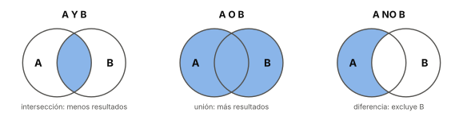

# Unidad 2. Recuperación de información {#sec-u2}

::: {.callout-note appearance="default"}
## Objetivos
- Aplicar los principios y las estrategias de la recuperación de información.
- Usar plataformas de recursos generales y especializados.
- Organizar la información encontrada.
:::

::: {.callout-note appearance="simple" icon="false"}
## Glosario de la unidad
[Necesidad de información](92-glosario.qmd#gl-necesidad) · [Operador booleano](92-glosario.qmd#gl-booleano) · [Truncamiento](92-glosario.qmd#gl-truncamiento) · [Búsqueda por campos](92-glosario.qmd#gl-campos) · [Precisión](92-glosario.qmd#gl-precision) · [Exhaustividad](92-glosario.qmd#gl-exhaustividad) · [Recolección de bayas](92-glosario.qmd#gl-bayas) · [Vocabulario controlado](92-glosario.qmd#gl-controlado)
:::

::: {.callout-tip appearance="simple" icon="false"}
## Descargas
[Script R del capítulo](plantillas/02_recuperacion.R){.btn .btn-outline-primary .btn-sm download="02_recuperacion.R"}
[Plantilla de entrega del reto (.qmd)](plantillas/entrega_reto.qmd){.btn .btn-outline-primary .btn-sm download="entrega_reto.qmd"}
[Tema de estilo (.scss)](plantillas/informe.scss){.btn .btn-outline-primary .btn-sm download="informe.scss"}
:::

## Lectura obligatoria

::: {.lectura}
Bates, M. J. (1989). [The design of browsing and berrypicking techniques for the online search interface](https://doi.org/10.1108/eb024320). *Online Review*, 13(5), 407-424.
:::

### Lecturas complementarias {.unnumbered}

- Marchionini, G. (2006). [Exploratory search: From finding to understanding](https://doi.org/10.1145/1121949.1121979). *Communications of the ACM*, 49(4), 41-46. La búsqueda como aprendizaje.
- Cruz Gil, C. (2015). *Modelos de búsqueda y recuperación de la información*. Trea (bibliografía básica de la asignatura).
- Pacios Lozano, A. R. (coord.) (2013). *Técnicas de búsqueda y uso de la información*. Ramón Areces (bibliografía básica).

## 1. De la necesidad a la estrategia

Toda búsqueda empieza por una **necesidad de información**: qué quieres saber y para qué. Antes de escribir nada en un buscador conviene:

1. **Formular la pregunta** en una frase: «¿Cómo afecta el uso del móvil al rendimiento académico de los universitarios?».
2. **Identificar los conceptos**: uso del móvil, rendimiento académico, universitarios.
3. **Buscar sinónimos y términos relacionados** de cada concepto, en español y en inglés (*smartphone*, *mobile phone*; *academic performance*, *achievement*; *university students*, *undergraduates*).
4. **Decidir los límites**: idioma, fechas, tipo de documento.

Bates (1989) mostró que la búsqueda real no es una consulta única que devuelve el conjunto perfecto, sino un proceso que llamó ***berrypicking*** (recolección de bayas): la necesidad cambia a medida que se lee, se recogen piezas útiles en cada paso y se usan técnicas variadas (seguir las referencias de un artículo, buscar a un autor, revisar una revista). Marchionini (2006) llama **búsqueda exploratoria** a la que sirve para aprender sobre un tema, frente a la que solo busca un dato.

## 2. Operadores y técnicas

| Técnica | Qué hace | Ejemplo |
|---|---|---|
| **Y** (AND) | Todos los términos: reduce resultados | `móvil AND rendimiento` |
| **O** (OR) | Cualquiera de los términos: amplía (sinónimos) | `móvil OR smartphone` |
| **NO** (NOT) | Excluye un término | `rendimiento NOT deportivo` |
| **Paréntesis** | Agrupan y ordenan las operaciones | `(móvil OR smartphone) AND rendimiento` |
| **Comillas** | Frase exacta | `"rendimiento académico"` |
| **Truncamiento** | Variantes de una raíz | `universitari*` encuentra universitario, universitaria, universitarios… |
| **Búsqueda por campos** | Solo en título, autor, resumen… | `title:(smartphone)` según la plataforma |

Cada plataforma tiene su sintaxis; la ayuda de cada buscador explica la suya. Además, muchas bases de datos usan un **vocabulario controlado** (tesauros, encabezamientos de materia): términos normalizados que agrupan los sinónimos y mejoran los resultados.

{#fig-booleanos fig-alt="Tres diagramas de Venn de dos círculos, A y B. En el primero, rotulado A Y B, solo está sombreada la zona común. En el segundo, A O B, están sombreados los dos círculos completos. En el tercero, A NO B, está sombreado el círculo A sin la zona común."}

## 3. Precisión y exhaustividad

Dos medidas clásicas describen una búsqueda:

- **Precisión**: de lo que he encontrado, ¿qué proporción me sirve?
- **Exhaustividad** (*recall*): de todo lo que me serviría, ¿qué proporción he encontrado?

Suelen moverse en direcciones opuestas: añadir sinónimos con O aumenta la exhaustividad y baja la precisión; añadir conceptos con Y aumenta la precisión y baja la exhaustividad. Un trabajo de clase necesita sobre todo precisión; una revisión de la literatura necesita exhaustividad.

## 4. Plataformas generales y especializadas

| Tipo | Ejemplos | Para qué |
|---|---|---|
| Buscadores generales | Google, Bing | Información general, webs institucionales, noticias |
| Buscadores académicos | [Google Académico](https://scholar.google.com/), [BASE](https://www.base-search.net/), [OpenAlex](https://openalex.org/) | Literatura científica de todas las áreas |
| Catálogos de bibliotecas | Catálogo de la biblioteca de la UC3M | Libros y recursos suscritos por la universidad |
| Bases de datos multidisciplinares | Web of Science, Scopus (con acceso de la universidad), [Dialnet](https://dialnet.unirioja.es/) | Artículos revisados, con filtros y vocabulario controlado; Dialnet, para la producción en español |
| Bases de datos especializadas | [PubMed](https://pubmed.ncbi.nlm.nih.gov/) (biomedicina), ERIC (educación), LISTA (biblioteconomía) | Búsqueda exhaustiva en un área |
| Repositorios | [Recolecta](https://www.recolecta.fecyt.es/), repositorios institucionales | Versiones en acceso abierto |

Algunos recursos requieren identificarse con la cuenta de la universidad o usar la VPN desde fuera del campus.

## 5. Organizar la información

Encontrar es la mitad del trabajo: la otra mitad es no perder lo encontrado. Conviene:

- **Guardar la estrategia** de búsqueda (dónde, con qué términos, cuándo y cuántos resultados), para poder repetirla y explicarla.
- Usar un **gestor de referencias** (Unidad 4) para guardar los documentos con sus datos.
- Crear **alertas** en las bases de datos para recibir las novedades.
- Tomar notas con la referencia completa desde el principio, para no tener que buscarla después.

## Práctica en R: los operadores booleanos por dentro

Un buscador trata cada término como el **conjunto** de documentos que lo contienen. En R, `intersect()` es Y, `union()` es O y `setdiff()` es NO:

```{webr}
#| autorun: true
movil      <- c(1, 2, 3, 5, 8, 13, 21)     # documentos que contienen «móvil»
smartphone <- c(2, 4, 8, 16, 32)           # los que contienen «smartphone»
rendimiento <- c(1, 2, 4, 8, 13, 16, 40)  # los que contienen «rendimiento»

union(movil, smartphone)                   # móvil OR smartphone
intersect(union(movil, smartphone), rendimiento)   # (móvil OR smartphone) AND rendimiento
```

### Ejercicio 2.1 {.unnumbered}

¿Cuántos documentos devuelve `(móvil OR smartphone) AND rendimiento`?

```{webr}
#| exercise: u2_and
#| setup: true
movil      <- c(1, 2, 3, 5, 8, 13, 21)
smartphone <- c(2, 4, 8, 16, 32)
rendimiento <- c(1, 2, 4, 8, 13, 16, 40)
```

```{webr}
#| exercise: u2_and
r <- intersect(union(movil, smartphone), ______)
length(r)
```

::: {.hint exercise="u2_and"}
El tercer concepto es `rendimiento`.
:::

::: {.solution exercise="u2_and"}
```r
r <- intersect(union(movil, smartphone), rendimiento)
length(r)
```
Seis documentos: 1, 2, 8, 13, 4 y 16. Sin el sinónimo *smartphone* solo habrías encontrado cuatro: añadir sinónimos con O aumenta la exhaustividad.
:::

```{webr}
#| exercise: u2_and
#| check: true
if (identical(as.integer(.result), 6L)) {
  list(correct = TRUE, message = "Correcto: 6 documentos.")
} else {
  list(correct = FALSE, message = "Intersecta con el vector rendimiento.")
}
```

### Ejercicio 2.2 {.unnumbered}

Has revisado los seis resultados y solo cuatro te sirven. Calcula la **precisión** de la búsqueda.

```{webr}
#| exercise: u2_precision
pertinentes <- 4
resultados <- 6
pertinentes / ______
```

::: {.hint exercise="u2_precision"}
La precisión es pertinentes entre resultados.
:::

::: {.solution exercise="u2_precision"}
```r
pertinentes <- 4
resultados <- 6
pertinentes / resultados
```
0,67: dos de cada tres resultados sirven.
:::

```{webr}
#| exercise: u2_precision
#| check: true
if (isTRUE(all.equal(as.numeric(.result), 4 / 6))) {
  list(correct = TRUE, message = "Correcto: precisión de 0,67.")
} else {
  list(correct = FALSE, message = "Divide entre resultados.")
}
```

## Reto evaluable {#reto-u2}

::: {.callout-important appearance="simple" icon="false"}
## Reto de la unidad 2 · Estrategia de búsqueda documentada
Elige un tema de tu interés relacionado con el grado:

1. Formula la **pregunta**, identifica los conceptos y haz una **tabla de términos** con sinónimos en español y en inglés.
2. Construye la **ecuación de búsqueda** con operadores, paréntesis, comillas y truncamiento.
3. Ejecútala en **tres plataformas** de tipos distintos (un buscador académico, una base de datos y un catálogo o repositorio), adaptando la sintaxis. Anota los resultados de cada una.
4. Selecciona los **cinco documentos** más pertinentes, explica por qué y calcula la precisión de la primera página de resultados de cada plataforma.

**Entrega:** un informe hecho con la [plantilla de entrega](plantillas/entrega_reto.qmd). Se evalúa con la rúbrica que incluye la plantilla. Este reto **no tiene solución en el libro**: cada estudiante elige un tema distinto y la corrección la hace el profesorado.
:::

## Autoevaluación

Responde a todas las preguntas y pulsa **Mostrar respuestas**: verás en verde las acertadas, en rojo las falladas y tu recuento. Puedes corregir y volver a comprobar. No cuenta para la nota.

::: {.webex-check .webex-box}
1. Para ampliar una búsqueda con sinónimos se usa el operador 
2. `universitari*` es un ejemplo de 
3. Añadir conceptos con AND suele aumentar la precisión y reducir la exhaustividad. 
4. Según Bates, la búsqueda real es una única consulta que devuelve el conjunto perfecto de documentos. 
5. Si encuentro 20 documentos y 5 me sirven, la precisión es 
6. ¿Para qué sirven las comillas en una búsqueda?



7. Para buscar literatura biomédica de forma exhaustiva, la plataforma más adecuada es 
8. La proporción de todos los documentos pertinentes que recupera una búsqueda es la 
9. Un tesauro es un ejemplo de vocabulario 
10. En `(móvil OR smartphone) AND rendimiento`, los paréntesis hacen que la O se resuelva antes que la Y. 
:::

::: {.webex-solution boton="Ver explicaciones"}
- OR suma conjuntos: cualquiera de los términos.
- El asterisco recupera todas las terminaciones de la raíz.
- Cada AND exige un concepto más: menos resultados, más pertinentes.
- Es un proceso de recolección de bayas que cambia a medida que se lee.
- 5 / 20 = 0,25.
- Las comillas fijan la frase completa y en orden.
- PubMed es la base de datos especializada en biomedicina.
- También se llama *recall*.
- Normaliza los términos y agrupa sinónimos.
- Igual que en una operación aritmética.
:::

## Recursos complementarios

| Recurso | Para qué sirve |
|---|---|
| [OpenAlex](https://openalex.org/) | Índice abierto de la literatura científica |
| [BASE](https://www.base-search.net/) | Buscador de documentos académicos en acceso abierto |
| [Dialnet](https://dialnet.unirioja.es/) | Literatura científica en español |
| [Recolecta](https://www.recolecta.fecyt.es/) | Repositorios españoles de acceso abierto |
| [*The information literacy user's guide*, capítulos de búsqueda](https://milnepublishing.geneseo.edu/the-information-literacy-users-guide-an-open-online-textbook/) | Manual abierto |
