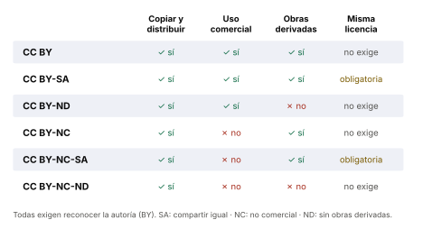
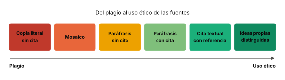
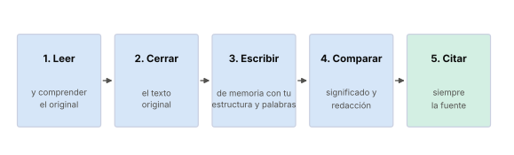

# Unidad 3. Uso ético de la información y plagio {#sec-u3}

::: {.callout-note appearance="default"}
## Objetivos
- Conocer los fundamentos de la propiedad intelectual y del derecho de cita.
- Reconocer los distintos tipos de plagio.
- Elaborar trabajos académicos sin plagio: citar, parafrasear y resumir correctamente.
:::

::: {.callout-note appearance="simple" icon="false"}
## Glosario de la unidad
[Propiedad intelectual](92-glosario.qmd#gl-propiedad) · [Derecho de cita](92-glosario.qmd#gl-cita) · [Dominio público](92-glosario.qmd#gl-dominio) · [Licencia Creative Commons](92-glosario.qmd#gl-cc) · [Plagio](92-glosario.qmd#gl-plagio) · [Paráfrasis](92-glosario.qmd#gl-parafrasis) · [Escritura en mosaico](92-glosario.qmd#gl-mosaico) · [Integridad académica](92-glosario.qmd#gl-integridad)
:::

::: {.callout-tip appearance="simple" icon="false"}
## Descargas
[Script R del capítulo](plantillas/03_etica_plagio.R){.btn .btn-outline-primary .btn-sm download="03_etica_plagio.R"}
[Plantilla de entrega del reto (.qmd)](plantillas/entrega_reto.qmd){.btn .btn-outline-primary .btn-sm download="entrega_reto.qmd"}
[Tema de estilo (.scss)](plantillas/informe.scss){.btn .btn-outline-primary .btn-sm download="informe.scss"}
:::

## Lectura obligatoria

::: {.lectura}
Pecorari, D.; Petrić, B. (2014). [Plagiarism in second-language writing](https://doi.org/10.1017/S0261444814000056). *Language Teaching*, 47(3), 269-302.
:::

### Lecturas complementarias {.unnumbered}

- [Real Decreto Legislativo 1/1996, Ley de Propiedad Intelectual](https://www.boe.es/buscar/act.php?id=BOE-A-1996-8930). Texto consolidado; el art. 32 regula las citas.
- @creativecommonssf

## 1. Ética de la información

Usar información de forma ética significa reconocer el trabajo de los demás, respetar sus derechos y no engañar a quien lee el propio trabajo. En la universidad, ese compromiso se llama **integridad académica**: honestidad, confianza, justicia, respeto y responsabilidad en el estudio y la investigación.

## 2. Propiedad intelectual

En España, la **Ley de Propiedad Intelectual** (Real Decreto Legislativo 1/1996) protege las creaciones originales (textos, imágenes, música, programas…) desde el momento de su creación, sin necesidad de registro. Distingue:

- **Derechos morales**: reconocimiento de la autoría e integridad de la obra. Son irrenunciables.
- **Derechos de explotación** (patrimoniales): reproducción, distribución, comunicación pública y transformación. Duran, con carácter general, toda la vida del autor y **70 años** después de su muerte; después la obra pasa al **dominio público**.

El **derecho de cita** (art. 32) permite incluir fragmentos de obras ajenas sin pedir permiso cuando se hace a título de cita o para su análisis, comentario o juicio crítico, con fines docentes o de investigación, en la medida justificada por ese fin, e **indicando la fuente y el nombre del autor**.

Las **licencias Creative Commons** permiten a los autores autorizar de antemano ciertos usos. Se combinan cuatro condiciones: **BY** (reconocimiento, presente en todas), **SA** (compartir igual), **NC** (no comercial) y **ND** (sin obras derivadas). Este libro, por ejemplo, tiene licencia CC BY 4.0.

{#fig-licencias fig-alt="Tabla con las seis licencias Creative Commons en filas (BY, BY-SA, BY-ND, BY-NC, BY-NC-SA, BY-NC-ND) y cuatro columnas: copiar y distribuir (todas sí), uso comercial (no en las tres NC), obras derivadas (no en las dos ND) y misma licencia (obligatoria en las dos SA)."}

## 3. Qué es el plagio

**Plagiar** es presentar como propio el trabajo, las ideas o las palabras de otra persona sin reconocerlo. @pecorari2014 distinguen el plagio **intencionado** del que nace de no saber escribir con fuentes, sobre todo al aprender a escribir en otro idioma o en un nuevo género académico. Los dos son plagio, pero el segundo se previene aprendiendo.

| Tipo | Qué es |
|---|---|
| **Copia literal** | Copiar texto sin comillas ni cita |
| **Escritura en mosaico** (*patchwriting*) | Copiar cambiando algunas palabras o el orden, manteniendo la estructura del original |
| **Paráfrasis sin cita** | Reformular bien las ideas ajenas, pero sin citar la fuente |
| **Plagio de ideas** | Usar el argumento, los datos o la estructura de otro sin reconocerlo |
| **Autoplagio** | Reutilizar un trabajo propio ya evaluado o publicado sin indicarlo |
| **Trabajo hecho por otros** | Entregar un trabajo encargado a otra persona o generado por una IA como si fuera propio |

En esta asignatura, el plagio o la copia en cualquier actividad supone **perder la nota de esa actividad**.

{#fig-espectro fig-alt="Seis recuadros en una línea, de rojo a verde: copia literal sin cita, mosaico, paráfrasis sin cita, paráfrasis con cita, cita textual con referencia e ideas propias distinguidas. Una flecha va de «Plagio» a «Uso ético»."}

## 4. Cómo escribir con fuentes sin plagiar

- **Cita textual**: las palabras exactas, entre comillas, con la referencia (y la página, si la hay). Para frases que importan por su forma exacta.
- **Paráfrasis**: la idea del autor con **tus palabras y tu estructura**, con la referencia. Truco: lee, cierra el texto, escribe lo que has entendido y después comprueba que no se parece demasiado al original.
- **Resumen**: las ideas principales de un texto largo, más breves, con la referencia.
- **Ideas propias**: no necesitan cita, pero deben distinguirse con claridad de las ajenas.
- **Conocimiento común** (hechos ampliamente conocidos y fáciles de comprobar): no necesita cita. En caso de duda, cita.

## Práctica en R: así detecta coincidencias un programa

Los programas de detección de coincidencias comparan fragmentos de palabras consecutivas. Una forma sencilla es dividir los textos en grupos de tres palabras (**trigramas**) y calcular qué proporción comparten (**similitud de Jaccard**: comunes / total distintos):

```{webr}
#| autorun: true
trigramas <- function(texto) {
  p <- strsplit(tolower(gsub("[[:punct:]]", "", texto)), "\\s+")[[1]]
  unique(paste(p[-c(length(p) - 1, length(p))], p[-c(1, length(p))], p[-(1:2)]))
}
similitud <- function(a, b) {
  ta <- trigramas(a); tb <- trigramas(b)
  length(intersect(ta, tb)) / length(union(ta, tb))
}
original <- "La lectura lateral consiste en salir de la página para comprobar qué dicen otras fuentes sobre ella"
mosaico  <- "La lectura lateral consiste en salir de la web para comprobar lo que dicen otras fuentes sobre ella"
parafrasis <- "Para verificar una web, conviene consultar qué opinan de ella fuentes distintas en lugar de analizarla por dentro"
c(mosaico = similitud(original, mosaico), parafrasis = similitud(original, parafrasis))
```

### Ejercicio 3.1 {.unnumbered}

Calcula la similitud entre el original y una **copia literal** (el mismo texto). ¿Qué valor esperas?

```{webr}
#| exercise: u3_copia
#| setup: true
trigramas <- function(texto) {
  p <- strsplit(tolower(gsub("[[:punct:]]", "", texto)), "\\s+")[[1]]
  unique(paste(p[-c(length(p) - 1, length(p))], p[-c(1, length(p))], p[-(1:2)]))
}
similitud <- function(a, b) {
  ta <- trigramas(a); tb <- trigramas(b)
  length(intersect(ta, tb)) / length(union(ta, tb))
}
original <- "La lectura lateral consiste en salir de la página para comprobar qué dicen otras fuentes sobre ella"
```

```{webr}
#| exercise: u3_copia
copia <- original
similitud(original, ______)
```

::: {.hint exercise="u3_copia"}
Compara el original con el objeto `copia`.
:::

::: {.solution exercise="u3_copia"}
```r
copia <- original
similitud(original, copia)
```
1: todos los trigramas coinciden. La escritura en mosaico da un valor intermedio y la paráfrasis bien hecha, casi 0. Por eso estos programas detectan bien la copia, peor el mosaico y casi nada la paráfrasis o la traducción: **no sustituyen al juicio** de quien corrige.
:::

```{webr}
#| exercise: u3_copia
#| check: true
if (isTRUE(all.equal(as.numeric(.result), 1))) {
  list(correct = TRUE, message = "Correcto: similitud 1, copia literal.")
} else {
  list(correct = FALSE, message = "Compara original con copia.")
}
```

## Laboratorio: así ve un detector de coincidencias {#lab-u3-detector}

::: {.laboratorio}
::: {.laboratorio-etiqueta}
Laboratorio · se ejecuta en tu navegador, sin enviar el texto a ningún sitio
:::

Pega un texto original y tu versión. El laboratorio divide los dos en grupos de tres palabras (**trigramas**), calcula qué proporción comparten (similitud de Jaccard) y **resalta** en tu versión las palabras que forman parte de trigramas copiados. Prueba con una copia literal, una escritura en mosaico y una paráfrasis de verdad.

```{ojs}
//| echo: false
texto = window.Lab.texto
area = window.Lab.area
seleccion = window.Lab.seleccion
rango = window.Lab.rango
boton = window.Lab.boton
```

```{ojs}
//| echo: false
viewof original = area("Texto original", {rows: 4, value: "La lectura lateral consiste en salir de la página para comprobar qué dicen otras fuentes sobre ella y sobre lo que afirma."})
viewof version = area("Tu versión", {rows: 4, value: "La lectura lateral consiste en salir de la web para comprobar lo que dicen otras fuentes sobre ella y sobre lo que afirma."})
```

```{ojs}
//| echo: false
{
  const palabras = t => t.toLowerCase().normalize("NFC").replace(/[^\p{L}\p{N}\s]/gu, " ").split(/\s+/).filter(Boolean);
  const tri = p => { const s = new Set(); for (let i = 0; i + 2 < p.length; i++) s.add(p.slice(i, i + 3).join(" ")); return s; };
  const pa = palabras(original), pb = palabras(version), ta = tri(pa), tb = tri(pb);
  const comunes = [...tb].filter(x => ta.has(x));
  const union = new Set([...ta, ...tb]);
  const j = union.size ? comunes.length / union.size : 0;
  const marcadas = new Array(pb.length).fill(false);
  for (let i = 0; i + 2 < pb.length; i++) if (ta.has(pb.slice(i, i + 3).join(" "))) { marcadas[i] = marcadas[i + 1] = marcadas[i + 2] = true; }
  const veredicto = j >= 0.8 ? "casi una copia literal" : j >= 0.25 ? "muchas coincidencias: posible escritura en mosaico" : j > 0 ? "pocas coincidencias" : "sin coincidencias de tres palabras";
  return html`<div role="status">
    <p><strong>Similitud: ${(100 * j).toFixed(0)} %</strong> (${comunes.length} trigramas compartidos de ${union.size} distintos) · ${veredicto}.</p>
    ${(() => { const p = document.createElement("p"); p.className = "lab-resaltado"; pb.forEach((w, i) => { if (i) p.append(" "); if (marcadas[i]) { const m = document.createElement("mark"); m.textContent = w; p.append(m); } else p.append(w); }); return p; })()}
    <p class="small">Recuerda: una similitud baja <em>no</em> prueba que no haya plagio (una paráfrasis o una traducción sin cita lo son), y una alta tampoco lo prueba si el fragmento está citado.</p></div>`;
}
```
:::

## Casos prácticos resueltos

::: {.callout-note appearance="simple" icon="false"}
## Caso 1 · Parafrasear paso a paso
**Texto original** (inventado para el ejemplo): «La revisión por pares, pese a sus limitaciones, sigue siendo el principal mecanismo de control de calidad de la literatura científica, aunque su eficacia para detectar errores ha sido cuestionada por numerosos estudios» (Pérez, 2021, p. 14).

{#fig-u3-parafrasis fig-alt="Cinco bloques en secuencia: leer y comprender el original, cerrar el texto original, escribir de memoria con tu estructura y palabras, comparar significado y redacción, y citar siempre la fuente."}

1. **Lee y comprende** el texto completo; luego **cierra** el original.
2. **Escribe de memoria** la idea con tus palabras y tu estructura: *Aunque se discute que detecte bien los errores, la evaluación por especialistas continúa siendo la herramienta central para garantizar la calidad de lo que se publica en ciencia (Pérez, 2021).*
3. **Compara** con el original: ¿has cambiado la estructura y el vocabulario, no solo algunos sinónimos?, ¿mantienes el significado?
4. **Cita** la fuente aunque hayas parafraseado.

**Mal ejemplo (*patchwriting*):** *La revisión por pares, a pesar de sus límites, continúa siendo el mecanismo principal de control de calidad de la literatura científica.* Cambia dos palabras y conserva la estructura: es plagio aunque se cite, porque se presenta como redacción propia.
:::

::: {.callout-note appearance="simple" icon="false"}
## Caso 2 · Reutilizar una imagen con licencia Creative Commons
Quieres usar en tu trabajo una fotografía de Wikimedia Commons con licencia **CC BY-SA 4.0**. La atribución completa sigue la regla **TASL**: *Title, Author, Source, License* (título, autor, fuente, licencia):

> «Biblioteca de la UC3M» por Ana López, Wikimedia Commons, CC BY-SA 4.0 (enlace a la imagen y a la licencia).

Si la modificas (por ejemplo, la recortas), indícalo («recortada del original»). Con **SA** (compartir igual), si publicas una obra derivada, debe llevar la misma licencia. Con **NC** (no comercial) no puedes usarla en un contexto comercial; con **ND** (sin obras derivadas) no puedes modificarla.
:::

::: {.callout-note appearance="simple" icon="false"}
## Caso 3 · Reutilizar tu propio trabajo
Quieres aprovechar en tu TFM tres páginas de un trabajo que entregaste en otra asignatura. Presentarlo como nuevo sin decirlo es **autoplagio**. Lo correcto: consultar las normas de la asignatura, citar tu trabajo anterior como cualquier otra fuente y reelaborar el texto, o pedir permiso al profesorado si se trata de ampliar un trabajo previo.
:::

## Ejercicios graduados

**Básico.** ¿Es plagio copiar una frase entre comillas, con su referencia y página?

::: {.webex-solution boton="Ver solución"}
No: es una **cita textual** correcta. Debe usarse con moderación y para frases cuyo enunciado exacto importa.
:::

**Intermedio.** Parafrasea este texto inventado y cítalo: «Los gestores de referencias reducen los errores de formato y ahorran tiempo, pero requieren revisar los metadatos importados» (Ruiz, 2022, p. 3).

::: {.webex-solution boton="Ver solución"}
Ejemplo: *Herramientas como Zotero facilitan dar formato a la bibliografía y evitan errores, siempre que se comprueben los datos que importan automáticamente (Ruiz, 2022).* Otras redacciones son válidas si cambian estructura y vocabulario y mantienen la idea.
:::

**Avanzado.** Toma un párrafo de un trabajo tuyo, pásalo por el laboratorio de coincidencias del capítulo con una fuente que usaste y reescribe las partes con coincidencias largas. Explica qué cambios hiciste.

::: {.webex-solution boton="Ver orientación"}
Las coincidencias de pocas palabras (términos técnicos, nombres) no son un problema; las secuencias largas con estructura idéntica sí. La reescritura debe partir de la comprensión, no de sustituir sinónimos.
:::


## Actividades

::: {.clasificar #ia-u3-plagio titulo="¿Qué tipo de plagio es?" categorias="Copia literal|Escritura en mosaico|Paráfrasis sin cita|Autoplagio|Trabajo hecho por otros|No es plagio"}
- Copias dos párrafos de Wikipedia sin comillas ni cita → Copia literal
- Cambias algunas palabras de un párrafo por sinónimos y mantienes su estructura → Escritura en mosaico
- Explicas con tus palabras la idea de un artículo, pero no lo citas → Paráfrasis sin cita // La idea sigue siendo ajena.
- Entregas en una asignatura el trabajo que ya presentaste en otra → Autoplagio
- Entregas un ensayo generado por un asistente de IA como si fuera tuyo → Trabajo hecho por otros
- Reproduces entre comillas una frase breve con su referencia y la comentas → No es plagio // Es una cita correcta, amparada por el derecho de cita.
- Escribes que el agua hierve a 100 ºC a nivel del mar sin citar → No es plagio // Es conocimiento común.
:::

::: {.escenario #ia-u3-licencia titulo="¿Qué licencia Creative Commons eliges?"}
Vas a publicar unos apuntes propios en abierto. Responde y te diremos qué licencia encaja (las cuatro respuestas son válidas: es tu decisión).

### ¿Permites usos comerciales? {#cc-com}
- [Sí, también comerciales](#cc-der-si)
- [No, solo usos no comerciales](#cc-der-nc)

### ¿Permites obras derivadas? {#cc-der-si}
Con usos comerciales permitidos.

- [Sí, y quien adapte puede elegir licencia](#cc-by)
- [Sí, pero las adaptaciones deben llevar la misma licencia](#cc-bysa)
- [No, solo copias sin modificar](#cc-bynd)

### ¿Permites obras derivadas? {#cc-der-nc}
Solo usos no comerciales.

- [Sí, y quien adapte puede elegir licencia](#cc-bync)
- [Sí, pero con la misma licencia](#cc-byncsa)
- [No, solo copias sin modificar](#cc-byncnd)

### CC BY {#cc-by .final .bien}
La más abierta: solo exige reconocimiento. Es la que usan este libro y muchas revistas en acceso abierto.

### CC BY-SA {#cc-bysa .final .bien}
Reconocimiento y compartir igual: las adaptaciones deben ser igual de abiertas (como Wikipedia).

### CC BY-ND {#cc-bynd .final .bien}
Reconocimiento y sin obras derivadas: se puede redistribuir, también comercialmente, pero sin cambios.

### CC BY-NC {#cc-bync .final .bien}
Reconocimiento y no comercial.

### CC BY-NC-SA {#cc-byncsa .final .bien}
Reconocimiento, no comercial y compartir igual.

### CC BY-NC-ND {#cc-byncnd .final .bien}
La más restrictiva: solo copiar y distribuir sin cambios, sin fines comerciales y citando.
:::

::: {.callout-warning appearance="simple" icon="false"}
## Errores frecuentes
- **«Si cambio las palabras ya es mío».** Las ideas, los datos y la estructura también se citan.
- **«Si está en internet, es libre».** Que algo sea accesible no significa que sea de dominio público ni que su licencia permita reutilizarlo.
- **Citar solo al final.** La referencia en la lista no basta: cada idea ajena necesita su cita en el lugar del texto donde la usas.
- **Fiarse del porcentaje** de la herramienta de originalidad, en un sentido o en otro.
- **Olvidar las imágenes y las figuras**: también tienen autor y licencia.
:::

## Reto evaluable {#reto-u3}

::: {.callout-important appearance="simple" icon="false"}
## Reto de la unidad 3 · Escribir con fuentes
Elige un artículo académico o de divulgación de tu interés:

1. Escribe un **resumen** de unas 150 palabras, una **paráfrasis** de un párrafo y una **cita textual** breve, cada uno con su referencia.
2. Escribe a propósito una versión en **mosaico** del mismo párrafo y explica por qué sería plagio.
3. Identifica la **licencia** del artículo y explica qué usos permite.
4. Reflexiona sobre qué situaciones de tu experiencia escolar o universitaria podrían haber sido plagio sin que lo supieras.

**Entrega:** un informe hecho con la [plantilla de entrega](plantillas/entrega_reto.qmd). Se evalúa con la rúbrica que incluye la plantilla. Este reto **no tiene solución en el libro**: cada estudiante trabaja con un texto distinto y la corrección la hace el profesorado.
:::

## Autoevaluación

Responde a todas las preguntas y pulsa **Mostrar respuestas**: verás en verde las acertadas, en rojo las falladas y tu recuento. Puedes corregir y volver a comprobar. No cuenta para la nota.

::: {.webex-check .webex-box}
1. Una paráfrasis bien escrita no necesita cita porque usa palabras propias. 
2. Copiar cambiando algunas palabras pero manteniendo la estructura del original se llama escritura en 
3. Los derechos morales de autor son irrenunciables. 
4. En una licencia Creative Commons, la condición que impide el uso comercial es 
5. Según la Ley de Propiedad Intelectual, con carácter general los derechos de explotación duran la vida del autor y 
6. Entregar como propio un trabajo generado por una IA es una forma de plagio. 
7. ¿Por qué un programa de detección de coincidencias no basta para decidir si hay plagio?



8. Reutilizar un trabajo propio ya evaluado sin indicarlo se llama 
9. La condición de Creative Commons presente en todas las licencias es 
10. Los hechos de conocimiento común, ampliamente conocidos y fáciles de comprobar, no necesitan cita. 
:::

::: {.webex-solution boton="Ver explicaciones"}
- La idea sigue siendo ajena: hay que citarla aunque las palabras sean propias.
- *Patchwriting*: cambiar palabras sin cambiar la estructura.
- El reconocimiento de la autoría no se puede ceder.
- NC, no comercial.
- 70 años tras la muerte del autor, con carácter general.
- Es presentar como propio un trabajo que no lo es.
- Mide coincidencias de texto, no si el uso de la fuente es correcto.
- También es una forma de plagio.
- Reconocimiento de la autoría.
- En caso de duda, mejor citar.
:::

## Recursos complementarios

| Recurso | Para qué sirve |
|---|---|
| [Ley de Propiedad Intelectual (BOE)](https://www.boe.es/buscar/act.php?id=BOE-A-1996-8930) | Texto consolidado |
| [Creative Commons – Licencias](https://creativecommons.org/licenses/?lang=es) | Elegir y entender una licencia |
| [*The information literacy user's guide*, capítulo sobre ética](https://milnepublishing.geneseo.edu/the-information-literacy-users-guide-an-open-online-textbook/) | Manual abierto |
