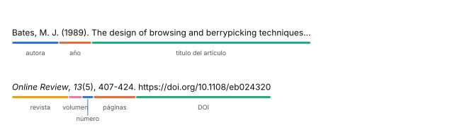

# Unidades 4 y 5. Referencias bibliográficas {#sec-u4}

::: {.callout-note appearance="default"}
## Objetivos
- Crear y gestionar referencias bibliográficas en los trabajos académicos.
- Aplicar un estilo de citación y ordenar las referencias.
- Conocer las herramientas de análisis de originalidad y sus límites.
:::

::: {.callout-note appearance="simple" icon="false"}
## Glosario de la unidad
[Cita](92-glosario.qmd#gl-cita-texto) · [Referencia bibliográfica](92-glosario.qmd#gl-referencia) · [Estilo de citación](92-glosario.qmd#gl-estilo) · [Sistema autor-fecha](92-glosario.qmd#gl-autor-fecha) · [Sistema numérico](92-glosario.qmd#gl-numerico) · [DOI](92-glosario.qmd#gl-doi) · [Gestor de referencias](92-glosario.qmd#gl-gestor) · [Herramienta de originalidad](92-glosario.qmd#gl-originalidad)
:::

::: {.callout-tip appearance="simple" icon="false"}
## Descargas
[Script R del capítulo](plantillas/04_referencias.R){.btn .btn-outline-primary .btn-sm download="04_referencias.R"}
[Plantilla de entrega del reto (.qmd)](plantillas/entrega_reto.qmd){.btn .btn-outline-primary .btn-sm download="entrega_reto.qmd"}
[Tema de estilo (.scss)](plantillas/informe.scss){.btn .btn-outline-primary .btn-sm download="informe.scss"}
:::

## Lectura obligatoria

::: {.lectura}
Gilmour, R.; Cobus-Kuo, L. (2011). [Reference management software: A comparative analysis of four products](https://doi.org/10.5062/F4Z60KZF). *Issues in Science and Technology Librarianship*, 66.
:::

### Lecturas complementarias {.unnumbered}

- Foltýnek, T. et al. (2020). [Testing of support tools for plagiarism detection](https://doi.org/10.1186/s41239-020-00192-4). *International Journal of Educational Technology in Higher Education*, 17, 46. Qué detectan y qué no las herramientas de originalidad.
- American Psychological Association. [APA Style](https://apastyle.apa.org/). Guía oficial del estilo APA 7.

## 1. Por qué citar

Citar sirve para **reconocer** el trabajo ajeno, **demostrar** en qué se apoya lo que dices, **permitir** a quien lee encontrar las fuentes y **distinguir** tus ideas de las de otros. En un trabajo académico hay dos elementos relacionados:

- La **cita en el texto**: una marca breve donde usas la fuente, como (Bates, 1989) o [3].
- La **referencia bibliográfica**: la descripción completa de la fuente en la lista final.

## 2. Estilos de citación

Un **estilo** fija qué datos se incluyen, en qué orden y con qué puntuación. Hay dos grandes sistemas:

| Sistema | Cita en el texto | Orden de la lista | Estilos |
|---|---|---|---|
| **Autor-fecha** | (Metzger y Flanagin, 2013) | Alfabético por apellido | APA 7, Harvard, Chicago autor-fecha |
| **Numérico** | [1] o superíndice | Por orden de aparición | Vancouver, IEEE, ISO 690 numérico |

En este grado se usa con frecuencia **APA 7.ª edición**. Lo importante es elegir un estilo, aplicarlo **de forma coherente** y seguir el que indique cada profesor o revista.

{#fig-apa fig-alt="La referencia de Bates (1989) en estilo APA, con cada parte subrayada en un color y rotulada debajo: autora, año, título del artículo, revista, volumen, número, páginas y DOI."}

## 3. Referencias de los tipos de documento más frecuentes (APA 7)

| Tipo | Patrón |
|---|---|
| Artículo de revista | Apellido, I. (Año). Título del artículo. *Revista*, *volumen*(número), páginas. https://doi.org/… |
| Libro | Apellido, I. (Año). *Título del libro* (ed.). Editorial. |
| Capítulo de libro | Apellido, I. (Año). Título del capítulo. En I. Apellido (Ed.), *Título del libro* (pp. x-y). Editorial. |
| Página web | Autor u organización. (Año, día mes). *Título*. Sitio web. URL |
| Ley | Título de la ley. *Boletín Oficial del Estado*, número, fecha. URL |

El **DOI** (*Digital Object Identifier*) es un identificador permanente de un documento digital. Si existe, se incluye como enlace `https://doi.org/…`: aunque la web de la revista cambie, el DOI seguirá llevando al documento.

## 4. Gestores de referencias

Un **gestor de referencias** guarda los documentos con sus datos, los organiza, inserta las citas en el procesador de textos y genera la bibliografía en cualquier estilo. Gilmour y Cobus-Kuo (2011) compararon varios gestores y encontraron que **todos cometen errores** al generar las referencias (mayúsculas, datos que faltan, formatos de nombres), así que **siempre hay que revisarlas**. Los más usados son **[Zotero](https://www.zotero.org/)** (libre y gratuito), Mendeley y EndNote.

Un flujo de trabajo recomendado:

1. Capturar la referencia desde la base de datos o el navegador (con el conector del gestor).
2. Comprobar y completar los datos.
3. Organizar en colecciones y etiquetas.
4. Citar desde el procesador de textos con el complemento del gestor.
5. Revisar la bibliografía final.

## 5. Herramientas de análisis de originalidad

Las universidades usan programas que comparan los trabajos con grandes bases de textos y señalan las coincidencias. Foltýnek et al. (2020) evaluaron muchas de estas herramientas y concluyeron que detectan bien la copia literal, pero tienen dificultades con las modificaciones (paráfrasis, sinónimos, traducciones) y que ninguna es perfecta. El informe de coincidencias es un **indicio**, no un veredicto: una cita bien hecha coincide con su fuente y no es plagio, y una paráfrasis sin cita puede no coincidir y sí serlo.

## Práctica en R: componer y ordenar referencias

`paste0()` une textos. Con ella se puede ver cómo un gestor compone una referencia a partir de sus datos:

```{webr}
#| autorun: true
autores <- "Bates, M. J."
anio <- 1989
titulo <- "The design of browsing and berrypicking techniques for the online search interface"
revista <- "Online Review"; volumen <- 13; numero <- 5; paginas <- "407-424"
doi <- "10.1108/eb024320"
paste0(autores, " (", anio, "). ", titulo, ". ", revista, ", ", volumen, "(", numero, "), ",
       paginas, ". https://doi.org/", doi)
```

### Ejercicio 4.1 {.unnumbered}

En el estilo APA, la lista se ordena **alfabéticamente** por el apellido del primer autor. Ordena estas referencias con `sort()` y escribe cuál queda en primer lugar.

```{webr}
#| exercise: u4_orden
#| setup: true
refs <- c("Pennycook, G., & Rand, D. G. (2021). The psychology of fake news.",
          "Bates, M. J. (1989). The design of browsing and berrypicking techniques.",
          "Metzger, M. J., & Flanagin, A. J. (2013). Credibility and trust of information.",
          "Bawden, D., & Robinson, L. (2009). The dark side of information.")
```

```{webr}
#| exercise: u4_orden
ordenadas <- ______(refs)
ordenadas[1]
```

::: {.hint exercise="u4_orden"}
La función que ordena un vector es `sort()`.
:::

::: {.solution exercise="u4_orden"}
```r
ordenadas <- sort(refs)
ordenadas[1]
```
Bates (1989): «Bat» va antes que «Baw». Los gestores ordenan así, letra a letra.
:::

```{webr}
#| exercise: u4_orden
#| check: true
if (startsWith(as.character(.result), "Bates")) {
  list(correct = TRUE, message = "Correcto: Bates va antes que Bawden.")
} else {
  list(correct = FALSE, message = "Ordena con sort().")
}
```

## Laboratorio: del DOI a la referencia {#lab-u4-doi}

::: {.laboratorio}
::: {.laboratorio-etiqueta}
Laboratorio · datos en vivo de Crossref
:::

Escribe un DOI y el laboratorio pide a [Crossref](https://www.crossref.org/) la referencia en **APA 7**, igual que hace un gestor bibliográfico. Después, **revísala**: busca mayúsculas de más, cursivas que faltan o datos incompletos. Es exactamente lo que encontraron Gilmour y Cobus-Kuo (2011).

```{ojs}
//| echo: false
texto = window.Lab.texto
area = window.Lab.area
seleccion = window.Lab.seleccion
rango = window.Lab.rango
boton = window.Lab.boton
```

```{ojs}
//| echo: false
viewof doi = texto("DOI", {value: "10.1016/j.pragma.2013.07.012", submit: "Obtener la referencia"})
```

```{ojs}
//| echo: false
referencia = {
  const limpio = doi.trim().replace(/^https?:\/\/(dx\.)?doi\.org\//i, "").replace(/^doi:\s*/i, "");
  if (!/^10\.\d{4,9}\/\S+$/.test(limpio)) { yield {aviso: "Eso no parece un DOI: empiezan por «10.» seguido de un prefijo y una barra."}; return; }
  yield {cargando: true};
  try {
    const r = await fetch(`https://api.crossref.org/v1/works/${encodeURIComponent(limpio)}/transform`, {headers: {Accept: "text/x-bibliography; style=apa"}});
    if (r.status === 404) { yield {aviso: "Crossref no conoce ese DOI. Puede ser de otra agencia (DataCite, por ejemplo) o no existir: compruébalo en https://doi.org/" + limpio}; return; }
    yield {texto: (await r.text()).trim(), doi: limpio};
  } catch (e) { yield {aviso: "No se ha podido consultar Crossref (¿estás sin conexión?)."}; }
}
```

```{ojs}
//| echo: false
referencia.cargando ? html`<p role="status">Consultando Crossref…</p>` :
referencia.aviso ? html`<p role="status">${referencia.aviso}</p>` :
html`<div role="status"><p><strong>Referencia generada:</strong></p><blockquote class="lab-cita">${referencia.texto}</blockquote>
<p class="small">¿Qué corregirías? En APA, el título del artículo va en minúscula salvo la primera palabra y los nombres propios, y la revista y el volumen van en cursiva (aquí se pierde el formato).</p></div>`
```

Prueba también: `10.1108/eb024320`, `10.1038/s41598-023-41032-5` o el DOI de este libro, `10.5281/zenodo.24515144` (de DataCite, no de Crossref).
:::

## Actividades

::: {.ordenar #ia-u4-apa titulo="Las partes de una referencia de artículo en APA 7"}
1. Autores
2. Año entre paréntesis
3. Título del artículo
4. Nombre de la revista, en cursiva
5. Volumen, en cursiva, y número entre paréntesis
6. Páginas o número de artículo
7. DOI como enlace
:::

::: {.clasificar #ia-u4-sistema titulo="¿Autor-fecha o numérico?" categorias="Autor-fecha|Numérico"}
- (Bates, 1989) → Autor-fecha
- [3] → Numérico
- Lista ordenada alfabéticamente por apellido → Autor-fecha
- Lista ordenada por orden de aparición → Numérico
- Estilo APA 7 → Autor-fecha
- Estilo Vancouver → Numérico
- Estilo IEEE → Numérico
- Estilo Harvard → Autor-fecha
:::

::: {.clasificar #ia-u4-tipo titulo="¿Qué tipo de documento es?" categorias="Artículo de revista|Libro|Capítulo de libro|Página web|Norma legal"}
- Cruz Gil, C. (2015). *Modelos de búsqueda y recuperación de la información*. Trea. → Libro
- Bates, M. J. (1989). The design of browsing… *Online Review*, *13*(5), 407-424. → Artículo de revista
- Real Decreto Legislativo 1/1996… *Boletín Oficial del Estado*, 97. → Norma legal
- Caulfield, M. (2019, 19 de junio). *SIFT (The four moves)*. Hapgood. → Página web
- Apellido, I. (2020). Título. En I. Editora (Ed.), *Título del libro* (pp. 10-25). Editorial. → Capítulo de libro
:::

::: {.callout-warning appearance="simple" icon="false"}
## Errores frecuentes
- **Mezclar estilos** en el mismo trabajo (unas referencias en APA, otras copiadas de la web de la revista).
- **No revisar lo que genera el gestor**: títulos en mayúsculas, nombres de revista abreviados o autores que faltan.
- **Citar la base de datos en lugar del documento** («Fuente: Dialnet»).
- **Escribir «DOI: 10.…»** en lugar del enlace completo `https://doi.org/10.…`.
- **Citas en el texto sin referencia**, o referencias en la lista que no se citan en el texto.
:::

## Reto evaluable {#reto-u4}

::: {.callout-important appearance="simple" icon="false"}
## Reto de las unidades 4 y 5 · Bibliografía con gestor
Con los documentos de tu reto de la unidad 2 (u otros diez sobre un tema que elijas):

1. Captúralos en **Zotero** (o en otro gestor) y organízalos en una colección.
2. Genera la bibliografía en **APA 7** y revisa cada referencia: documenta **todos los errores** que corriges.
3. Incluye al menos un artículo con DOI, un libro, un capítulo, una página web y una ley.
4. Escribe un párrafo con tres **citas en el texto** y explica la diferencia entre el sistema autor-fecha y el numérico con tu propio ejemplo.

**Entrega:** un informe hecho con la [plantilla de entrega](plantillas/entrega_reto.qmd). Se evalúa con la rúbrica que incluye la plantilla. Este reto **no tiene solución en el libro**: cada estudiante trabaja con documentos distintos y la corrección la hace el profesorado.
:::

## Autoevaluación

Responde a todas las preguntas y pulsa **Mostrar respuestas**: verás en verde las acertadas, en rojo las falladas y tu recuento. Puedes corregir y volver a comprobar. No cuenta para la nota.

::: {.webex-check .webex-box}
1. En el sistema autor-fecha, la lista de referencias se ordena 
2. Vancouver e IEEE son estilos del sistema 
3. El identificador permanente de un documento digital que se incluye como enlace en la referencia es el 
4. Las referencias que genera un gestor bibliográfico son siempre correctas. 
5. En APA 7, el título de la revista se escribe en cursiva. 
6. Un informe de coincidencias del 0 % garantiza que el trabajo no tiene plagio. 
7. ¿Cuál es la diferencia entre cita y referencia?



8. En APA 7, una obra de tres o más autores se cita en el texto con «et al.» desde la primera cita. 
9. ¿Qué gestor de referencias es libre y gratuito? 
10. En un sistema numérico, la lista de referencias se ordena por 
:::

::: {.webex-solution boton="Ver explicaciones"}
- Por apellido del primer autor.
- Numeran las citas por orden de aparición.
- *Digital Object Identifier*, permanente aunque cambie la web.
- Gilmour y Cobus-Kuo encontraron errores en todos: hay que revisarlas.
- Revista y volumen van en cursiva.
- Una paráfrasis sin cita puede no coincidir y seguir siendo plagio.
- La cita remite a la referencia completa.
- Desde la primera vez, a diferencia de APA 6.
- Zotero es software libre.
- El número corresponde al orden de cita.
:::

## Recursos complementarios

| Recurso | Para qué sirve |
|---|---|
| [APA Style](https://apastyle.apa.org/) | Guía oficial del estilo APA 7 |
| [Zotero](https://www.zotero.org/) | Gestor de referencias libre |
| [Crossref](https://www.crossref.org/) | Registro de DOI y búsqueda de metadatos |
| [Apéndice: guía rápida de citas](90-citas.qmd) | Ejemplos en APA 7 de este libro |
