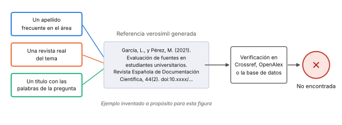

# Unidades 6 y 7. Inteligencia artificial generativa: fundamentos y aplicaciones {#sec-u5}

::: {.callout-note appearance="default"}
## Objetivos
- Explicar qué es la IA generativa y cómo producen texto los modelos de lenguaje.
- Conocer sus aplicaciones innovadoras, sus retos técnicos y las líneas de investigación abiertas.
- Reconocer sus usos responsables en el estudio y sus límites, en particular las alucinaciones.
- Verificar la información y las referencias que produce una IA.
:::

::: {.callout-note appearance="simple" icon="false"}
## Glosario de la unidad
[Inteligencia artificial generativa](92-glosario.qmd#gl-iag) · [Modelo de lenguaje](92-glosario.qmd#gl-llm) · [Instrucción (prompt)](92-glosario.qmd#gl-prompt) · [Alucinación](92-glosario.qmd#gl-alucinacion) · [Datos de entrenamiento](92-glosario.qmd#gl-entrenamiento) · [Generación aumentada por recuperación](92-glosario.qmd#gl-rag)
:::

::: {.callout-tip appearance="simple" icon="false"}
## Descargas
[Script R del capítulo](plantillas/05_ia_fundamentos.R){.btn .btn-outline-primary .btn-sm download="05_ia_fundamentos.R"}
[Plantilla de entrega del reto (.qmd)](plantillas/entrega_reto.qmd){.btn .btn-outline-primary .btn-sm download="entrega_reto.qmd"}
[Tema de estilo (.scss)](plantillas/informe.scss){.btn .btn-outline-primary .btn-sm download="informe.scss"}
:::

## Lectura obligatoria

::: {.lectura}
Walters, W. H.; Wilder, E. I. (2023). [Fabrication and errors in the bibliographic citations generated by ChatGPT](https://doi.org/10.1038/s41598-023-41032-5). *Scientific Reports*, 13, 14045.
:::

### Lecturas complementarias {.unnumbered}

- Kasneci, E. et al. (2023). [ChatGPT for good? On opportunities and challenges of large language models for education](https://doi.org/10.1016/j.lindif.2023.102274). *Learning and Individual Differences*, 103, 102274.
- Bender, E. M.; Gebru, T.; McMillan-Major, A.; Shmitchell, S. (2021). [On the dangers of stochastic parrots: Can language models be too big?](https://doi.org/10.1145/3442188.3445922) En *Proceedings of FAccT '21* (pp. 610-623). ACM.

::: {.callout-note appearance="simple"}
El bloque de IA generativa ocupa las unidades 6 a 9 del programa. Este capítulo cubre los fundamentos, las aplicaciones y los retos técnicos (unidades 6 y 7); el siguiente, la ética, la autoría y la regulación (unidades 8 y 9).
:::

## 1. Qué es la IA generativa

La **inteligencia artificial generativa** produce contenido nuevo (texto, imágenes, audio, código) a partir de patrones aprendidos de grandes cantidades de datos. Los asistentes conversacionales se basan en **modelos de lenguaje**: sistemas entrenados con enormes colecciones de textos para predecir la palabra (en realidad, el fragmento de palabra) más probable que sigue a un texto dado. Repitiendo esa predicción una y otra vez, el modelo escribe respuestas fluidas.

De ahí se siguen tres consecuencias importantes:

- El modelo produce lo **plausible**, no necesariamente lo **verdadero**. Bender et al. (2021) los llamaron, de forma crítica, «loros estocásticos»: combinan formas lingüísticas sin acceso propio al significado ni a los hechos.
- Lo que sabe depende de sus **datos de entrenamiento**: puede no conocer hechos recientes y reproducir los sesgos de esos datos.
- La forma de pedir importa: una **instrucción** (*prompt*) clara, con contexto, objetivo y formato, da mejores resultados.

Algunos sistemas combinan el modelo con un buscador o una base de documentos y responden a partir de lo que recuperan (**generación aumentada por recuperación**). Mejora la actualidad y permite enlazar fuentes, pero no elimina los errores: hay que comprobar que la fuente dice lo que el sistema afirma.

## 2. Aplicaciones innovadoras y retos técnicos

La IA generativa se usa ya para redactar y traducir textos, resumir documentos, escribir y revisar código, crear imágenes, audio y vídeo, apoyar la atención al público con asistentes conversacionales o ayudar a buscar y organizar información. En el ámbito de la información y la documentación aparecen aplicaciones como la descripción automática de colecciones, la transcripción de documentos históricos o los buscadores que responden en lenguaje natural citando sus fuentes.

Sus **retos técnicos** marcan las líneas de investigación abiertas:

| Reto | En qué consiste |
|---|---|
| **Veracidad** | Reducir las alucinaciones y anclar las respuestas en fuentes comprobables |
| **Actualidad** | Incorporar información posterior al entrenamiento sin reentrenar todo el modelo |
| **Explicabilidad** | Entender por qué el modelo produce una respuesta concreta |
| **Sesgos** | Detectar y mitigar los sesgos heredados de los datos |
| **Eficiencia** | Reducir el consumo de energía y el coste de entrenar y usar los modelos |
| **Evaluación** | Medir de forma fiable qué saben hacer y dónde fallan |
| **Detección** | Distinguir contenido generado de contenido humano, algo que hoy no se consigue con fiabilidad |

## 3. Alucinaciones

Una **alucinación** es una respuesta que parece correcta pero es falsa o inventada. En el trabajo académico, la más peligrosa es la **referencia inventada**: un artículo con autores, título, revista y DOI verosímiles que no existe. Walters y Wilder (2023) pidieron a ChatGPT revisiones bibliográficas breves y comprobaron cada referencia: una gran parte de las citas de GPT-3.5 eran inventadas, y con GPT-4 seguía habiendo una proporción menor pero apreciable; además, muchas referencias reales tenían errores.

{#fig-alucinacion fig-alt="A la izquierda, tres piezas: un apellido de autor del área, el nombre de una revista real y un título sobre el tema. Se combinan en una referencia completa y verosímil. Una flecha lleva a una lupa de verificación en una base de datos, que devuelve: no encontrada."}

## 4. Usos responsables en el estudio

Kasneci et al. (2023) revisan oportunidades (explicaciones adaptadas, apoyo a la escritura, práctica personalizada) y riesgos (dependencia, errores, sesgos, plagio). Un criterio práctico es distinguir los usos según lo que delegas:

| Uso | Riesgo | Buenas prácticas |
|---|---|---|
| Pedir que te explique un concepto | Medio | Contrastar con un manual o una fuente fiable |
| Generar ideas o un esquema inicial | Bajo-medio | Usarlo como punto de partida, no como resultado |
| Revisar la ortografía y la claridad de tu texto | Bajo | Revisar cada cambio; el texto sigue siendo tuyo |
| Buscar bibliografía | **Alto** | Verificar **cada** referencia en una base de datos |
| Resumir un documento | Medio | Leer el original; el resumen puede omitir o inventar |
| Escribir el trabajo por ti | **Inaceptable** | Es presentar como propio un trabajo ajeno (Unidad 3) |

Antes de usar IA en una asignatura, comprueba qué permite el profesorado y declara su uso cuando sea necesario (lo verás en el capítulo siguiente).

## 5. Cómo verificar lo que produce una IA

1. **Referencias**: busca cada una por su DOI (en `doi.org` o [Crossref](https://www.crossref.org/)) o por su título en Google Académico, [OpenAlex](https://openalex.org/) o la base de datos de tu área. Comprueba autores, año y revista.
2. **Datos y hechos**: aplica la lectura lateral y SIFT (Unidad 1).
3. **Citas atribuidas**: localiza la frase en la fuente original.
4. **Contenido**: comprueba que la fuente real dice lo que la IA afirma que dice.

## Práctica en R: verificar referencias contra una base de datos

El operador `%in%` comprueba qué elementos de un vector están en otro. Imagina que una IA te ha dado cinco DOI y tienes una lista con los DOI que existen en una base de datos:

```{webr}
#| autorun: true
doi_ia <- c("10.1108/eb024320", "10.1016/j.ipm.2019.102041", "10.1038/s41598-023-41032-5",
            "10.1177/0165551508095781", "10.1093/jis/abc123")
base_datos <- c("10.1108/eb024320", "10.1038/s41598-023-41032-5", "10.1177/0165551508095781",
                "10.1016/j.pragma.2013.07.012", "10.1145/1121949.1121979")
doi_ia %in% base_datos
```

### Ejercicio 6.1 {.unnumbered}

Calcula la **proporción de referencias inventadas** (las que no están en la base de datos). Recuerda que `!` invierte un valor lógico y que `mean()` de un vector lógico da la proporción de `TRUE`.

```{webr}
#| exercise: u5_inventadas
#| setup: true
doi_ia <- c("10.1108/eb024320", "10.1016/j.ipm.2019.102041", "10.1038/s41598-023-41032-5",
            "10.1177/0165551508095781", "10.1093/jis/abc123")
base_datos <- c("10.1108/eb024320", "10.1038/s41598-023-41032-5", "10.1177/0165551508095781",
                "10.1016/j.pragma.2013.07.012", "10.1145/1121949.1121979")
```

```{webr}
#| exercise: u5_inventadas
mean(!(doi_ia %in% ______))
```

::: {.hint exercise="u5_inventadas"}
Compara con el vector `base_datos`.
:::

::: {.solution exercise="u5_inventadas"}
```r
mean(!(doi_ia %in% base_datos))
```
0,4: dos de las cinco referencias no aparecen. En la práctica, que un DOI no esté en una lista no prueba que no exista: hay que buscarlo en `doi.org`. Pero un DOI con un formato extraño o que no resuelve es una señal clara de referencia inventada.
:::

```{webr}
#| exercise: u5_inventadas
#| check: true
if (isTRUE(all.equal(as.numeric(.result), 0.4))) {
  list(correct = TRUE, message = "Correcto: el 40 % no está en la base de datos.")
} else {
  list(correct = FALSE, message = "Usa base_datos dentro de %in%.")
}
```

## Reto evaluable {#reto-u5}

::: {.callout-important appearance="simple" icon="false"}
## Reto de las unidades 6 y 7 · Auditar las referencias de una IA
1. Pide a un asistente de IA generativa una lista de **diez referencias académicas** sobre un tema de tu interés. Guarda la instrucción y la respuesta completas.
2. Verifica **cada referencia**: ¿existe? ¿son correctos los autores, el año, el título, la revista y el DOI? ¿El contenido corresponde al tema?
3. Clasifica cada una como **correcta**, **real con errores** o **inventada**, y calcula las proporciones.
4. Repite la búsqueda en una base de datos (Unidad 2) y compara la calidad de los resultados y el tiempo empleado.

**Entrega:** un informe hecho con la [plantilla de entrega](plantillas/entrega_reto.qmd). Se evalúa con la rúbrica que incluye la plantilla. Este reto **no tiene solución en el libro**: cada estudiante trabaja con un tema distinto y la corrección la hace el profesorado.
:::

## Autoevaluación

Responde a todas las preguntas y pulsa **Mostrar respuestas**: verás en verde las acertadas, en rojo las falladas y tu recuento. Puedes corregir y volver a comprobar. No cuenta para la nota.

::: {.webex-check .webex-box}
1. Un modelo de lenguaje genera texto prediciendo el fragmento más probable que sigue a un texto dado. 
2. Una respuesta de una IA que parece correcta pero es falsa o inventada se llama 
3. Si una IA da una referencia con DOI, autores y revista, la referencia existe. 
4. ¿Cuál de estos usos tiene mayor riesgo? 
5. Si 3 de 12 referencias generadas por una IA son inventadas, la proporción de inventadas es 
6. La generación aumentada por recuperación elimina por completo los errores. 
7. ¿Por qué un modelo de lenguaje puede inventar una referencia verosímil?



8. Lo que sabe un modelo de lenguaje depende de sus datos de 
9. Hoy existen detectores que distinguen con total fiabilidad el texto generado por IA del humano. 
10. Para comprobar si existe una referencia dada por una IA, lo más fiable es 
:::

::: {.webex-solution boton="Ver explicaciones"}
- Repite esa predicción para escribir la respuesta.
- Respuesta plausible pero falsa.
- Puede estar inventada: hay que verificarla.
- Walters y Wilder encontraron muchas referencias inventadas.
- 3 / 12 = 0,25.
- Mejora la actualidad, pero hay que comprobar las fuentes.
- Produce lo plausible, no lo verdadero; no hay intención.
- Puede no conocer hechos recientes y heredar sus sesgos.
- La detección es uno de los retos técnicos abiertos.
- La IA puede confirmar con seguridad una referencia falsa.
:::

## Recursos complementarios

| Recurso | Para qué sirve |
|---|---|
| [Crossref](https://www.crossref.org/) | Comprobar DOI y metadatos |
| [OpenAlex](https://openalex.org/) | Buscar si un artículo existe |
| [UNESCO – Guidance for generative AI in education and research (Miao y Holmes, 2023)](https://unesdoc.unesco.org/ark:/48223/pf0000386693) | Orientaciones internacionales |
