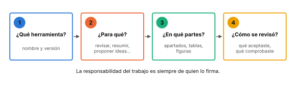
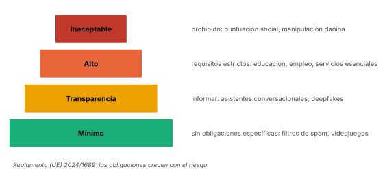

# Unidades 8 y 9. Inteligencia artificial generativa: ética, autoría y regulación {#sec-u6}

::: {.callout-note appearance="default"}
## Objetivos
- Analizar los principios éticos de la IA generativa: consentimiento, privacidad y autodeterminación informativa.
- Comprender la responsabilidad y la autoría en el uso de la IA.
- Declarar de forma transparente el uso de IA en los trabajos académicos.
- Conocer el marco normativo europeo y los principios éticos de la IA.
:::

::: {.callout-note appearance="simple" icon="false"}
## Glosario de la unidad
[Sesgo algorítmico](92-glosario.qmd#gl-sesgo) · [Declaración de uso de IA](92-glosario.qmd#gl-declaracion) · [Reglamento de IA](92-glosario.qmd#gl-aiact) · [Alfabetización en IA](92-glosario.qmd#gl-alfia) · [Explicabilidad](92-glosario.qmd#gl-explicabilidad) · [Datos personales](92-glosario.qmd#gl-personales) · [Autodeterminación informativa](92-glosario.qmd#gl-autodeterminacion)
:::

::: {.callout-tip appearance="simple" icon="false"}
## Descargas
[Plantilla de entrega del reto (.qmd)](plantillas/entrega_reto.qmd){.btn .btn-outline-primary .btn-sm download="entrega_reto.qmd"}
[Tema de estilo (.scss)](plantillas/informe.scss){.btn .btn-outline-primary .btn-sm download="informe.scss"}
:::

## Lectura obligatoria

::: {.lectura}
Floridi, L.; Cowls, J. (2019). [A unified framework of five principles for AI in society](https://doi.org/10.1162/99608f92.8cd550d1). *Harvard Data Science Review*, 1(1).
:::

### Lecturas complementarias {.unnumbered}

- [Reglamento (UE) 2024/1689, de Inteligencia Artificial](https://eur-lex.europa.eu/eli/reg/2024/1689/oj?locale=es). *Diario Oficial de la Unión Europea*.
- Bender, E. M. et al. (2021). [On the dangers of stochastic parrots](https://doi.org/10.1145/3442188.3445922). Costes ambientales y sesgos de los grandes modelos.

## 1. Principios éticos de la IA

Floridi y Cowls (2019) compararon las principales declaraciones internacionales sobre ética de la IA y las resumieron en **cinco principios**:

| Principio | Qué significa |
|---|---|
| **Beneficencia** | Promover el bienestar de las personas y del planeta |
| **No maleficencia** | Evitar daños: privacidad, seguridad, mal uso |
| **Autonomía** | Que las personas conserven la capacidad de decidir |
| **Justicia** | Repartir beneficios, evitar la discriminación |
| **Explicabilidad** | Que se pueda entender cómo funciona y quién responde |

Los cuatro primeros vienen de la bioética; el quinto es específico de la IA y hace posibles los demás.

## 2. Riesgos éticos en el uso cotidiano

- **Sesgos**: los modelos reproducen los sesgos de sus datos de entrenamiento (de género, de origen, de idioma). Una respuesta puede ser neutral en apariencia y sesgada en el fondo.
- **Consentimiento, privacidad y autodeterminación informativa**: la **autodeterminación informativa** es el derecho de cada persona a decidir qué se hace con sus datos personales; en España, el Tribunal Constitucional lo reconoce como derecho fundamental a la protección de datos. Los modelos se entrenan a menudo con datos recogidos de internet sin el consentimiento de sus autores, y lo que escribes en un asistente puede almacenarse y, según el servicio, usarse para entrenar modelos. No introduzcas datos personales propios ni ajenos, ni documentos confidenciales, y revisa la configuración de privacidad del servicio.
- **Autoría y propiedad intelectual**: un texto generado no es tuyo; además, los modelos se entrenan con obras protegidas, un debate jurídico abierto.
- **Dependencia y aprendizaje**: delegar en la IA lo que la asignatura quiere que aprendas te impide aprenderlo.
- **Coste ambiental**: entrenar y usar grandes modelos consume mucha energía y agua (Bender et al., 2021).

## 3. Responsabilidad, autoría y transparencia

En el trabajo académico, la regla general es la **transparencia**: si usas IA, dilo, explica para qué y asume la responsabilidad del resultado. Las editoriales científicas y el comité COPE coinciden en que una IA **no puede ser autora**, porque no puede responsabilizarse del trabajo.

Una declaración útil indica **qué herramienta** (y versión), **para qué** se usó, **en qué partes** y **cómo** se revisó el resultado. Por ejemplo:

> Declaración de uso de IA: he usado [herramienta, versión] para revisar la ortografía y la claridad de los apartados 2 y 3, y para proponer sinónimos en la tabla de términos de búsqueda. He revisado y aceptado o rechazado cada propuesta. Las búsquedas, la selección de documentos y las conclusiones son mías. No he introducido datos personales.

Si la IA influye en el contenido, APA recomienda además citarla en el texto y en las referencias, indicando la instrucción usada en el apéndice o en el texto.

{#fig-declaracion fig-alt="Cuatro tarjetas en fila con las preguntas de una declaración de uso de IA: qué herramienta y versión, para qué se usó, en qué partes del trabajo y cómo se revisó el resultado. Debajo, una nota: la responsabilidad del trabajo es siempre de quien lo firma."}

## 4. El marco normativo europeo

El **Reglamento (UE) 2024/1689** de Inteligencia Artificial (*AI Act*) es la primera ley integral sobre IA. Sigue un **enfoque basado en el riesgo**:

| Nivel de riesgo | Ejemplos | Consecuencia |
|---|---|---|
| **Inaceptable** | Puntuación social, manipulación que cause daño | Prohibido |
| **Alto** | IA en educación para evaluar o admitir estudiantes, en empleo, en servicios esenciales | Requisitos estrictos: gestión de riesgos, datos de calidad, supervisión humana |
| **Transparencia** | Asistentes conversacionales, contenido generado (*deepfakes*) | Informar de que se interactúa con una IA o de que el contenido es artificial |
| **Mínimo** | Filtros de correo no deseado, videojuegos | Sin obligaciones específicas |

{#fig-riesgos fig-alt="Pirámide de cuatro niveles, de arriba abajo: inaceptable (prohibido: puntuación social, manipulación dañina), alto (requisitos estrictos: educación, empleo, servicios esenciales), transparencia (informar: asistentes conversacionales, deepfakes) y mínimo (sin obligaciones específicas: filtros de spam, videojuegos)."}

Además, el reglamento regula los **modelos de IA de uso general** (los que están detrás de los asistentes) y obliga a quienes despliegan sistemas de IA a procurar que su personal tenga un nivel suficiente de **alfabetización en IA**. Sus obligaciones se aplican de forma escalonada desde 2025. Otras normas, como el Reglamento General de Protección de Datos, siguen aplicándose a la IA.

## Casos prácticos resueltos

::: {.callout-note appearance="simple" icon="false"}
## Caso 1 · Redactar una declaración de uso de IA
En tu TFG usaste un asistente de IA para revisar la ortografía y para proponer una primera estructura del índice. Una declaración adecuada:

> Durante la elaboración de este trabajo se utilizó [nombre de la herramienta, versión] para revisar la ortografía y la gramática del texto y para obtener una propuesta inicial de estructura del índice, que fue modificada por la autora. Todo el contenido fue redactado, revisado y verificado por la autora, que asume la responsabilidad del trabajo. No se usó IA para generar resultados, análisis ni referencias.

Elementos clave: **qué herramienta**, **para qué tareas**, **qué hiciste tú** y **responsabilidad**. Consulta siempre la normativa de tu universidad y de la asignatura.
:::

::: {.callout-note appearance="simple" icon="false"}
## Caso 2 · Datos personales en un chatbot
Para analizar las respuestas abiertas de una encuesta, piensas pegarlas en un chatbot comercial. Contienen nombres y comentarios sobre la salud de los participantes. Problemas: son **datos personales**, algunos de **categoría especial** (salud), y el RGPD exige una base legal, información a los participantes y garantías sobre dónde y cómo se tratan. Alternativas: **anonimizar** antes (eliminar nombres e información identificable), usar herramientas aprobadas por la universidad con garantías contractuales o hacer el análisis de forma local. Ante la duda, consulta al delegado de protección de datos.
:::

::: {.callout-note appearance="simple" icon="false"}
## Caso 3 · ¿En qué categoría de riesgo está? (Reglamento europeo de IA)
El Reglamento (UE) 2024/1689 clasifica los usos de la IA por su riesgo:

| Categoría | Ejemplos | Consecuencia |
|---|---|---|
| **Riesgo inaceptable** | Puntuación social de las personas; manipulación que causa daño | Prohibido |
| **Alto riesgo** | IA para decidir el acceso a la educación o evaluar al alumnado; selección de personal | Requisitos estrictos: gestión de riesgos, datos, supervisión humana, transparencia |
| **Riesgo de transparencia** | Chatbots; contenidos generados o manipulados (ultrafalsificaciones) | Informar de que se interactúa con una IA o de que el contenido es artificial |
| **Riesgo mínimo** | Filtros de correo no deseado, videojuegos | Sin obligaciones específicas |

Un sistema que corrige automáticamente exámenes y decide la nota estaría en la categoría de **alto riesgo**.
:::

## Ejercicios graduados

**Básico.** ¿Quién es responsable del contenido de un trabajo hecho con ayuda de una IA?

::: {.webex-solution boton="Ver solución"}
La persona autora. La IA no puede ser autora ni asumir responsabilidad; quien firma responde de la exactitud y la originalidad del trabajo.
:::

**Intermedio.** Clasifica en las categorías del Reglamento: (a) un chatbot de atención al estudiante; (b) un sistema que decide la admisión a un máster; (c) un corrector ortográfico.

::: {.webex-solution boton="Ver solución"}
(a) Riesgo de transparencia: debe informar de que es una IA. (b) Alto riesgo: afecta al acceso a la educación. (c) Riesgo mínimo.
:::

**Avanzado.** Analiza un caso real o verosímil de uso de IA en tu entorno académico con los principios éticos del capítulo y propón una política breve para tu asignatura o grupo.

::: {.webex-solution boton="Ver orientación"}
Una buena política dice qué usos se permiten, cuáles no, cómo se declaran, qué pasa con los datos personales y cómo se verifica el trabajo. Debe ser coherente con la normativa de la universidad.
:::

## Actividades

::: {.clasificar #ia-u6-riesgo titulo="¿Qué nivel de riesgo le da el Reglamento de IA?" categorias="Inaceptable (prohibido)|Alto|Transparencia|Mínimo"}
- Un sistema que puntúa a los ciudadanos por su comportamiento social para darles o negarles servicios → Inaceptable (prohibido)
- Un sistema que decide la admisión de estudiantes en un máster → Alto
- Un sistema que corrige y califica exámenes universitarios → Alto
- Un asistente conversacional en la web de un ayuntamiento → Transparencia // Debe informar de que hablas con una IA.
- Un vídeo generado con IA que imita a una persona real (*deepfake*) → Transparencia // Debe indicarse que es artificial.
- Un filtro de correo no deseado → Mínimo
- Un sistema que filtra currículos para un proceso de selección → Alto
- Un sistema que manipula de forma subliminal a las personas y les causa daño → Inaceptable (prohibido)
:::

::: {.clasificar #ia-u6-principios titulo="¿Qué principio de Floridi y Cowls se pone en juego?" categorias="Beneficencia|No maleficencia|Autonomía|Justicia|Explicabilidad"}
- Un sistema de concesión de becas rechaza a un estudiante y nadie sabe explicarle por qué → Explicabilidad
- Un modelo de selección de personal penaliza los currículos de mujeres → Justicia
- Un asistente filtra datos personales de usuarios en sus respuestas → No maleficencia
- Una aplicación decide por ti qué asignaturas cursar sin que puedas cambiarlo → Autonomía
- Un sistema ayuda a detectar a tiempo el abandono escolar para ofrecer apoyo → Beneficencia
:::

::: {.escenario #ia-u6-declarar titulo="¿Hay que declararlo?"}
Estás terminando el trabajo final de una asignatura. La guía docente pide declarar cualquier uso de IA generativa.

### Qué has hecho {#u6d-inicio}
Has usado un asistente para corregir la ortografía y para proponerte sinónimos en la tabla de términos de búsqueda. Todo lo demás lo has hecho tú.

- [No lo declaro: solo ha sido la ortografía](#u6d-nodeclara)
- [Lo declaro indicando herramienta, para qué y en qué partes](#u6d-declara)

### Sin declarar {#u6d-nodeclara .final .mal}
La guía pide declarar **cualquier** uso. Aunque el uso sea menor y legítimo, ocultarlo incumple las normas de la asignatura y puede tratarse como falta de integridad.

### La declaración {#u6d-declara}
¿Cómo la redactas?

- [«He usado IA.»](#u6d-vaga)
- [«He usado (herramienta y versión) para revisar la ortografía y proponer sinónimos en la tabla del apartado 2. He revisado cada cambio; la búsqueda, la selección y las conclusiones son mías.»](#u6d-buena)

### Demasiado vaga {#u6d-vaga .final .regular}
Quien lee no sabe qué parte es tuya. Indica qué herramienta, para qué, en qué partes y cómo revisaste el resultado.

### Declaración completa {#u6d-buena .final .bien}
Transparente, concreta y asumiendo la responsabilidad del resultado: exactamente lo que piden las editoriales científicas y COPE.
:::

::: {.callout-warning appearance="simple" icon="false"}
## Errores frecuentes
- **Pensar que «declarar» es «confesar».** Declarar un uso permitido es una buena práctica, no una falta.
- **Creer que la declaración traslada la responsabilidad a la herramienta.** Quien firma responde de todo el trabajo.
- **Introducir datos personales o confidenciales** en servicios que pueden usarlos para entrenar modelos.
- **Suponer que el Reglamento de IA solo afecta a las empresas tecnológicas**: también obliga a quienes usan (despliegan) sistemas de alto riesgo, como una universidad.
:::

## Práctica

Busca la política de uso de IA de la UC3M o de la asignatura y la política sobre IA de una revista de tu área. Compáralas: ¿qué permiten, qué prohíben y qué piden declarar?

## Reto evaluable {#reto-u6}

::: {.callout-important appearance="simple" icon="false"}
## Reto de las unidades 8 y 9 · Caso ético y declaración de uso
1. Elige un **caso real** de uso de IA generativa con problemas éticos (en educación, periodismo, ciencia o cultura), documentado en al menos dos fuentes fiables.
2. Analízalo con los **cinco principios** de Floridi y Cowls.
3. Sitúalo en los **niveles de riesgo** del Reglamento europeo de IA y explica qué obligaciones se aplicarían.
4. Redacta la **declaración de uso de IA** de tu propio informe (aunque no hayas usado ninguna, explícitalo).

**Entrega:** un informe hecho con la [plantilla de entrega](plantillas/entrega_reto.qmd). Se evalúa con la rúbrica que incluye la plantilla. Este reto **no tiene solución en el libro**: cada estudiante analiza un caso distinto y la corrección la hace el profesorado.
:::

## Autoevaluación

Responde a todas las preguntas y pulsa **Mostrar respuestas**: verás en verde las acertadas, en rojo las falladas y tu recuento. Puedes corregir y volver a comprobar. No cuenta para la nota.

::: {.webex-check .webex-box}
1. El principio que Floridi y Cowls añaden a los cuatro de la bioética es la 
2. Una IA puede figurar como coautora de un artículo científico si ha escrito buena parte del texto. 
3. Según el Reglamento europeo de IA, un sistema de IA usado para evaluar a estudiantes es de riesgo 
4. La puntuación social de las personas está 
5. Es buena práctica introducir datos personales de compañeros en un asistente de IA para que redacte un trabajo de grupo. 
6. El Reglamento europeo de IA sigue un enfoque basado en el 
7. ¿Qué debe incluir una declaración de uso de IA?



8. El derecho de cada persona a decidir sobre el uso de sus datos personales se llama autodeterminación 
9. Informar de que un contenido ha sido generado por IA es una obligación del nivel de riesgo 
10. Si declaras el uso de IA, dejas de ser responsable de los errores que contenga el trabajo. 
:::

::: {.webex-solution boton="Ver explicaciones"}
- Hace posibles los otros cuatro principios.
- La autoría exige responsabilidad, y una IA no puede asumirla.
- La educación y la evaluación de estudiantes son ámbitos de alto riesgo.
- Es una práctica prohibida.
- Pone en riesgo la privacidad de otras personas.
- Las obligaciones crecen con el riesgo.
- Así quien lee sabe qué es tuyo y qué no.
- Base del derecho a la protección de datos.
- Afecta a asistentes y contenidos sintéticos.
- La responsabilidad sigue siendo de quien firma.
:::

## Recursos complementarios

| Recurso | Para qué sirve |
|---|---|
| [Reglamento (UE) 2024/1689](https://eur-lex.europa.eu/eli/reg/2024/1689/oj?locale=es) | Texto oficial del Reglamento de IA |
| [COPE – Authorship and AI tools](https://publicationethics.org/cope-position-statements/ai-author) | Posición sobre IA y autoría |
| [APA Style – How to cite ChatGPT](https://apastyle.apa.org/blog/how-to-cite-chatgpt) | Citar contenido generado por IA |
| [UNESCO – Recomendación sobre la ética de la IA](https://www.unesco.org/es/artificial-intelligence/recommendation-ethics) | Marco ético internacional |
